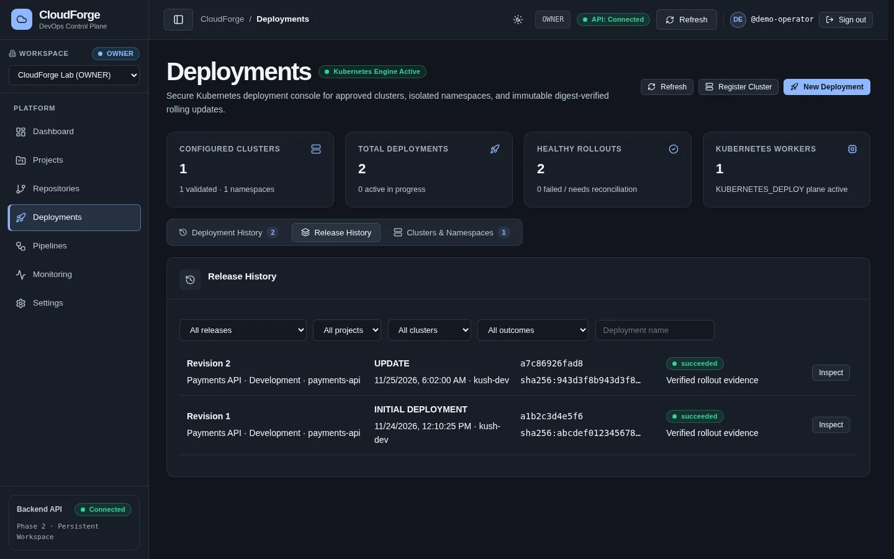
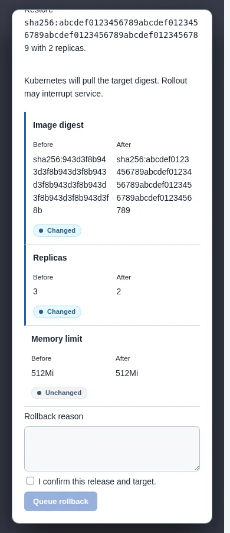

# CloudForge

**Self-Service Cloud Deployment and DevOps Automation Platform (`v1.0.0`)**

> **Implementation Status:** All planned engineering milestones (**Phases 1–4**, plus final stabilization) are **implemented in GitHub**.
> **Deployment Boundary:** The existing Render staging service (`cloudforge-staging`) runs the **control plane + bundled React SPA** with privileged execution subsystems (workers, secret delivery, source acquisition, OCI builds, Kubernetes deploys, and tracing) **disabled by default** via `application-render.yml`. Full worker, BuildKit, OCI registry, Kubernetes, and Prometheus/Grafana stacks run locally via Docker Compose and disposable Kubernetes clusters, or on separate appropriately sized infrastructure.

---

## 1. Project Overview

CloudForge is a full-stack DevOps control plane and execution platform built with Java 17 (Spring Boot 3.5), React 19 + TypeScript, PostgreSQL 17, Docker, BuildKit, Kubernetes, Prometheus/Grafana, and supply-chain verification primitives (Trivy, CycloneDX SBOM, Cosign).

It provides engineering teams with:
- Multi-workspace governance with backend-enforced RBAC (`OWNER`, `DEVELOPER`, `VIEWER`) and immutable workspace audit logs.
- GitHub OAuth 2.0 user authentication, GitHub App repository discovery, HMAC-SHA256 verified webhooks, and GitHub Actions workflow synchronization.
- Persistent DAG pipeline definitions, queued runs, concurrency fencing, and isolated worker execution via a dedicated standalone `worker/` module.
- Envelope-encrypted (AES-256-GCM) workspace/environment secrets with lease-bound worker delivery.
- Immutable GitHub archive source acquisition, BuildKit OCI image builds, registry publishing, and `sha256:` digest verification.
- Least-privilege namespaced Kubernetes deployments, immutable release history, pre-flight rollback previews, verified rollbacks, and read-only cluster reconciliation.
- Bearer-protected Prometheus metrics, Grafana dashboards, Alertmanager rules, worker Prometheus textfile telemetry, ECS structured logs, and fail-closed signed artifact security evidence gating for production releases.

---

## 2. Final Architecture

```text
+-----------------------------------------------------------------------------+
| Browser (React 19 + TypeScript + Vite SPA — Dark / Light / System Themes)  |
|  - Same-origin cookie session (CLOUDFORGE_SESSION) + X-XSRF-TOKEN CSRF     |
+--------------------------------------+--------------------------------------+
                                       | HTTPS / HTTP
                                       v
+-----------------------------------------------------------------------------+
| CloudForge Control Plane (backend/ — Spring Boot 3.5, Java 17, Flyway V1-11)|
|  - OAuth2 + GitHub App + Webhooks + RBAC + Audit Events                    |
|  - Pipelines, Leases/Fencing, AES-256-GCM Secrets, OCI & K8s Release Ledger|
|  - Artifact Security Evidence (ECDSA / Cosign PEM) + Bearer /prometheus    |
+-------------------+------------------------------------+--------------------+
                    | JDBC (Flyway V1-V11, 37 tables)    | Internal Worker API
                    v                                    | (Bearer Token + Fencing)
+-----------------------------------+                    v
| PostgreSQL 17                     |    +------------------------------------+
| - Control-plane state, leases,    |    | Isolated Worker (worker/ JAR)      |
|   encrypted secrets, releases,    |    | - Heartbeats, lease renewal, logs  |
|   audit & security evidence       |    | - Hardened Docker executor         |
+-----------------------------------+    | - Source acquisition + BuildKit    |
                                         | - OCI Registry push (sha256)       |
                                         | - Namespaced K8s deploy/rollback   |
                                         | - node_exporter cloudforge.prom    |
                                         +---------+----------------+---------+
                                                   |                |
                                                   v                v
                                         +----------------+  +------------------+
                                         | OCI Registry   |  | Kubernetes       |
                                         | (registry:2 /  |  | (Isolated NS +   |
                                         |  GHCR / etc.)  |  |  Least-Priv RBAC)|
                                         +----------------+  +------------------+

Optional Sidecar Observability Stack (compose.monitoring.yaml):
  Prometheus -> Backend (/actuator/prometheus, Bearer token), postgres-exporter, node-exporter (cloudforge.prom)
  Alertmanager <- Prometheus rules (8 alerts) | Grafana (5 provisioned dashboards) | OTel Collector (opt-in)
```

See [`docs/ARCHITECTURE.md`](docs/ARCHITECTURE.md) for the detailed component, data-flow, and trust-boundary design.

---

## 3. Technology Stack

| Layer | Technologies | Scope & Status |
| --- | --- | --- |
| **Frontend** | React 19, TypeScript 5.8, Vite 6, React Router 7, Lucide Icons, Vitest, Testing Library | **Implemented & verified** (single-origin SPA bundle + standalone hardened Nginx image) |
| **Backend Control Plane** | Java 17, Spring Boot 3.5, Maven 3.9, Spring Security 6, OAuth2 Client, Spring Data JPA, Flyway 10, BouncyCastle, Nimbus JOSE+JWT, Micrometer, Actuator | **Implemented & verified** (`backend/target/cloudforge-backend.jar`) |
| **Isolated Worker** | Java 17 shaded executable JAR (`worker/`), Docker Engine CLI isolation, BuildKit (`docker buildx`), Official Kubernetes Java Client (`client-java`) | **Implemented & verified** locally/CI; **disabled on Render** |
| **Database** | PostgreSQL 17 (`postgres:17-alpine`), Flyway migrations `V1`–`V11` (37 tables) | **Implemented & verified** (fresh, V2-to-V11 upgrade, repeatability, `pg_dump`/`pg_restore`) |
| **OCI & Kubernetes** | `registry:2` (local), BuildKit, `kind` / `k3s`, NetworkPolicy, ResourceQuota, LimitRange, namespaced ServiceAccount RBAC | **Implemented & verified** locally & in CI |
| **Observability** | Prometheus v3.5, Grafana, Alertmanager v0.28, `postgres_exporter`, `node_exporter` textfile (`cloudforge.prom`), OTel Collector, Spring Boot ECS JSON logging | **Implemented & verified** via config checks, backend tests, and local compose |
| **DevSecOps / Supply Chain** | Trivy v0.69 (vuln, secret, CycloneDX SBOM), Cosign v2.5 (ECDSA signing/verification), backend `ArtifactEvidenceService` fail-closed production gate | **Implemented & verified** (operator-side script + CI + backend policy enforcement) |
| **CI/CD & Hosting** | GitHub Actions (`.github/workflows/ci.yml`: backend, frontend, worker+kind, phase4), Render Free Docker (`Dockerfile.render`) | **Implemented**; Render staging awaits explicit approval before deploy |

---

## 4. Completed Milestones

| Milestone | Scope | Repository Status | Render Staging Status |
| --- | --- | --- | --- |
| **Phase 1** | Full-stack foundation, PostgreSQL 17 JDBC health probe, Docker Compose, CI | Implemented & verified | Active |
| **Phase 2** | GitHub OAuth 2.0, GitHub App, HMAC webhooks, workspaces, RBAC, projects, environments, audit logs | Implemented & verified | Active (requires GitHub env vars) |
| **Phase 3.1** | GitHub Actions workflow discovery & read-only synchronization | Implemented & verified | Active when GitHub App configured |
| **Phase 3.2** | Persistent DAG pipeline definitions, runs, cancellation, concurrency rules | Implemented & verified | Control-plane CRUD active |
| **Phase 3.3** | Authenticated isolated workers, leasing, fencing, heartbeats, hardened Docker runner | Implemented & verified locally/CI | **Disabled by default** (`application-render.yml`) |
| **Phase 3.4** | AES-256-GCM encrypted secrets, rotation/revocation, lease-bound worker delivery | Implemented & verified | **Disabled by default** (`application-render.yml`) |
| **Phase 3.5** | Immutable GitHub archive source acquisition, BuildKit OCI builds & registry publishing | Implemented & verified locally/CI | **Disabled by default** (`application-render.yml`) |
| **Phase 3.6** | Least-privilege Kubernetes deployment engine, namespaces, RBAC, rolling updates | Implemented & verified locally/CI | **Disabled by default** (`application-render.yml`) |
| **Phase 3.7** | Immutable release history, comparison, verified rollback & read-only reconciliation | Implemented & verified locally/CI | Metadata/UI active; execution **disabled** |
| **Phase 4** | Prometheus, Grafana, Alertmanager, ECS logging, Trivy/SBOM/Cosign signed artifact evidence, container hardening | Implemented & verified | Evidence APIs active; monitoring sidecar external |
| **Final Stabilization (`1.0.0`)** | Cross-platform worker telemetry, PEM key verification, ECS log profile, runbook links, Render SPA cache & 512 MiB tuning, V2-to-V11 migration verification, complete docs | Implemented & verified | Ready for explicit approval checkpoint |

See [`docs/ROADMAP.md`](docs/ROADMAP.md) for the complete milestone matrix.

---

## 5. Screenshots

Captured from the CloudForge console during Phase 3.7 verification (release history and rollback pre-flight preview):

| Release History | Rollback Pre-Flight Preview |
| --- | --- |
|  |  |

---

## 6. Installation & Local Development

### Prerequisites
- **Java 17** (Eclipse Temurin recommended) and **Maven 3.9+**
- **Node.js 24+** and **npm 11+**
- **Docker Engine** (Docker Desktop / WSL 2 on Windows, or native Linux Docker)
- **Optional for full local execution:** `kubectl`, a disposable Kubernetes cluster (`kind` or `k3s`), `trivy`, and `cosign`

### Quick Start (Control Plane + Frontend)

1. **Create your local environment file (ignored by Git):**
   ```bash
   cp .env.example .env
   ```
   *(On Windows PowerShell: `Copy-Item .env.example .env`)*
2. **Optional — Configure GitHub OAuth & GitHub App credentials:**
   Follow [`docs/GITHUB_INTEGRATION.md`](docs/GITHUB_INTEGRATION.md) for callback URLs, permissions, and webhook secrets.
3. **Start PostgreSQL 17 and the Spring Boot backend (applies Flyway `V1`–`V11` automatically):**
   ```bash
   docker compose up -d --build
   ```
4. **Start the React frontend dev server:**
   ```bash
   cd frontend
   npm ci
   npm run dev
   ```
5. Open **http://localhost:5173** and check `http://localhost:8080/api/health`.

Each component (`backend/`, `frontend/`, `worker/`, `compose.monitoring.yaml`, local `registry:2`, disposable Kubernetes) can be started independently without launching the full stack. See [`docs/DEVELOPMENT.md`](docs/DEVELOPMENT.md) for step-by-step instructions.

---

## 7. Platform Capabilities

### Authentication & Workspace Governance
- **GitHub OAuth 2.0:** Authorization-code login (`read:user`, `user:email`), HTTP-only `CLOUDFORGE_SESSION` cookie, open-redirect validation, and SPA CSRF protection (`X-XSRF-TOKEN`).
- **Workspace RBAC:** Backend-enforced `OWNER`, `DEVELOPER`, and `VIEWER` roles across every workspace-scoped endpoint, with immutable workspace audit logs (`GET /api/workspaces/{id}/audit-events`).

### GitHub App, Webhooks & GitHub Actions Sync
- RS256 App JWT generation with short-lived in-memory installation tokens (never written to browser storage or logs).
- State-bound installation callback, repository discovery/sync, constant-time HMAC-SHA256 webhook verification (`X-Hub-Signature-256`) with database deduplication (`webhook_deliveries`), and read-only GitHub Actions workflow/run discovery.

### Pipeline Orchestration & Isolated Worker Execution
- Versioned DAG pipeline definitions (`projects` -> `pipeline_definitions` -> `pipeline_runs` -> `stage_executions` -> `stage_execution_attempts`).
- Dedicated `worker/` executable JAR authenticates via per-worker Bearer credentials (`CLOUDFORGE_WORKER_CREDENTIALS` / `CLOUDFORGE_WORKER_TOKEN`), claims stages with database-backed leases and monotonic fencing tokens, renews heartbeats, streams bounded redacted logs, and executes approved operations in hardened Docker containers (`--cap-drop=ALL`, `--security-opt=no-new-privileges`, `--read-only`, `--network=none`, `--pids-limit`, non-root UID, zero host Docker socket mount).

### Encrypted Environment Secrets (Phase 3.4)
- Envelope encryption using AES-256-GCM with operator-managed keyring IDs (`CLOUDFORGE_SECRETS_KEYRING` + `CLOUDFORGE_SECRETS_ACTIVE_KEY_ID`), write-only `OWNER` metadata APIs, rotation/revocation, and lease-bound one-time worker delivery. Fails closed unless explicitly configured.

### Immutable Source Acquisition, BuildKit OCI Builds & Registry Publishing (Phase 3.5)
- Resolves immutable Git commit SHAs and downloads pinned repository archives.
- Builds OCI images via BuildKit in isolated worker contexts, publishes to configured registries (including disposable `registry:2`), and records verified `sha256:` image digests in PostgreSQL (`container_image_artifacts`).

### Kubernetes Deployment Engine, Release History & Verified Rollback (Phases 3.6–3.7)
- Deploys digest-pinned workloads into pre-provisioned isolated namespaces (`infrastructure/kubernetes/local/provision-local-namespace.sh`) with least-privilege `cloudforge-deployer` RoleBinding, `ResourceQuota`, `LimitRange`, and default-deny `NetworkPolicy`.
- Maintains immutable release revisions (`kubernetes_releases`), supports revision comparison, pre-flight rollback previews with stale-preview invalidation, verified rollback execution, and read-only cluster reconciliation.

### Monitoring & Observability (Phase 4)
- Optional sidecar stack via `docker compose -f compose.yaml -f compose.monitoring.yaml up -d`.
- Backend exposes `/actuator/prometheus` **only** when the `monitoring` profile is active and requests present a valid `>= 32`-character Bearer token (`cloudforge.monitoring.token` / `CLOUDFORGE_MONITORING_TOKEN`, mounted via Docker secret `metrics_token` in `compose.monitoring.yaml`, constant-time verified, `GET`-only).
- Includes 5 provisioned Grafana dashboards (`infrastructure/monitoring/grafana/dashboards/`), 8 Prometheus alert rules (`alerts.yml`), Alertmanager routing, `postgres_exporter`, cross-platform worker Prometheus textfile metrics (`cloudforge.prom`), ECS structured JSON console logging (`logging.structured.format.console: ecs`), and an opt-in OpenTelemetry Collector.
- See [`infrastructure/monitoring/README.md`](infrastructure/monitoring/README.md).

### DevSecOps & Signed Artifact Security Evidence (Phase 4)
- Operator-side assessment workflow (`infrastructure/supplychain/assess-image.sh`) executes Trivy vulnerability/secret scans, generates CycloneDX SBOMs, and signs the assessment envelope with Cosign (ECDSA P-256).
- Backend `ArtifactEvidenceService` verifies signatures against configured public keys (supporting both raw DER Base64 and standard Cosign PEM public keys), persists `artifact_security_evidence`, and enforces fail-closed `requireProductionApproval` gating before production releases.
- **Honest scope note:** Automatic in-pipeline `SECURITY_SCAN` worker stage execution is **not** implemented; supply-chain scanning is performed via the operator-side script and CI workflow, while policy verification and production gating are enforced automatically by the backend.

---

## 8. Render Staging Deployment

CloudForge maintains a single-origin Docker deployment profile for Render Free tier (`./Dockerfile.render` + `SPRING_PROFILES_ACTIVE=render`):
- Existing Web Service: `cloudforge-staging` (`https://cloudforge-staging.onrender.com`, Free 512 MiB plan, auto-deploy disabled)
- Existing Database: `cloudforge-staging-db` (PostgreSQL 17 Free, Singapore, expires **December 23, 2026**)
- All privileged execution subsystems (`workers`, `secrets`, `source`, `oci`, `kubernetes`, `tracing`) remain explicitly locked `false` in [`backend/src/main/resources/application-render.yml`](backend/src/main/resources/application-render.yml).
- **Important:** Do not trigger deployment or run destructive database operations without following the backup, V2-to-V11 migration verification, and approval procedure in [`docs/RENDER_FINAL_DEPLOYMENT.md`](docs/RENDER_FINAL_DEPLOYMENT.md) and [`docs/RENDER_STAGING.md`](docs/RENDER_STAGING.md).

---

## 9. Testing & Verification

```bash
# Backend (unit, security, RBAC, supply chain, monitoring, Flyway; add TEST_POSTGRES_* for live PG 17)
cd backend
mvn -B test
mvn -B package -DskipTests

# Worker (unit, Windows/POSIX telemetry, real Docker isolation, real BuildKit + registry:2)
cd worker
mvn -B test
mvn -B package -DskipTests

# Frontend (TypeScript, Vitest + React Testing Library, Vite production build)
cd frontend
npm ci
npm run typecheck
npm test
npm run build

# Docker Compose configuration validation
docker compose config --quiet
```

See [`docs/FINAL_INTEGRATION_TEST_REPORT.md`](docs/FINAL_INTEGRATION_TEST_REPORT.md) for exact test outputs, disposable Kubernetes (`k3s` / `kind`) deployment/rollback verification, V2-to-V11 PostgreSQL upgrade results, and Render 512 MiB container metrics.

---

## 10. Security Limitations & Production-Readiness Boundaries

- **Single-tenant / trusted internal scope:** While backend RBAC, CSRF, encrypted secrets, worker fencing, digest pinning, and least-privilege Kubernetes RBAC are implemented, untrusted multi-tenant public execution requires hardened VM/microVM build isolation (e.g., Firecracker/Kata), external KMS/HSM secret key management, externalized session storage (Redis/JDBC sessions), TLS termination + WAF/rate limiting, and dedicated non-expiring managed PostgreSQL with automated backups.
- **Render Free tier constraints:** Render's 512 MiB web service hosts only the control plane and SPA. Workers, BuildKit, OCI registries, Kubernetes clusters, and Prometheus/Grafana cannot and must not run inside the Render web service.
- **External credentials required for live integrations:** GitHub OAuth sign-in, GitHub App repository sync, public webhooks, external OCI registries, and remote Kubernetes clusters require configuring environment credentials.

---

## 11. Project Documentation Index

| Document | Purpose |
| --- | --- |
| [`docs/FINAL_PROJECT_COMPLETION_REPORT.md`](docs/FINAL_PROJECT_COMPLETION_REPORT.md) | Authoritative capstone completion report (Sections A–Z) |
| [`docs/FINAL_AUDIT.md`](docs/FINAL_AUDIT.md) | Complete repository audit and feature verification matrix |
| [`docs/FINAL_INTEGRATION_TEST_REPORT.md`](docs/FINAL_INTEGRATION_TEST_REPORT.md) | Recorded local, Docker, BuildKit, K3s, PG V2->V11, and Render test evidence |
| [`docs/FINAL_SECURITY_REVIEW.md`](docs/FINAL_SECURITY_REVIEW.md) | End-to-end security control review and remaining limitations |
| [`docs/RENDER_FINAL_DEPLOYMENT.md`](docs/RENDER_FINAL_DEPLOYMENT.md) | Approved Render release procedure, backup/restore & recovery runbook |
| [`docs/CAPSTONE_DEMO_GUIDE.md`](docs/CAPSTONE_DEMO_GUIDE.md) | Reproducible academic demonstration walkthrough & offline fallback |
| [`docs/ARCHITECTURE.md`](docs/ARCHITECTURE.md) | Full-stack architecture and trust boundaries |
| [`docs/ROADMAP.md`](docs/ROADMAP.md) | Implemented vs. deployment-enabled milestone tracker |
| [`docs/DEVELOPMENT.md`](docs/DEVELOPMENT.md) | Local development, isolated stack commands, and troubleshooting |
| [`docs/GITHUB_INTEGRATION.md`](docs/GITHUB_INTEGRATION.md) | GitHub OAuth App, GitHub App, and Webhook configuration |
| [`docs/RENDER_STAGING.md`](docs/RENDER_STAGING.md) | Render staging profile, environment variables, and safety locks |
| [`infrastructure/monitoring/README.md`](infrastructure/monitoring/README.md) | Prometheus, Grafana, Alertmanager, and OTel runbook |
| [`infrastructure/kubernetes/README.md`](infrastructure/kubernetes/README.md) | Namespace isolation and least-privilege RBAC provisioning |

---

## License

This project is licensed under the MIT License — see [`LICENSE`](LICENSE) for details.
