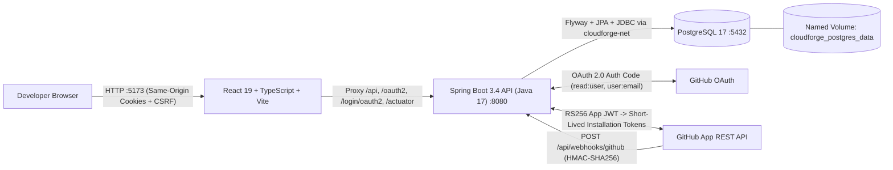
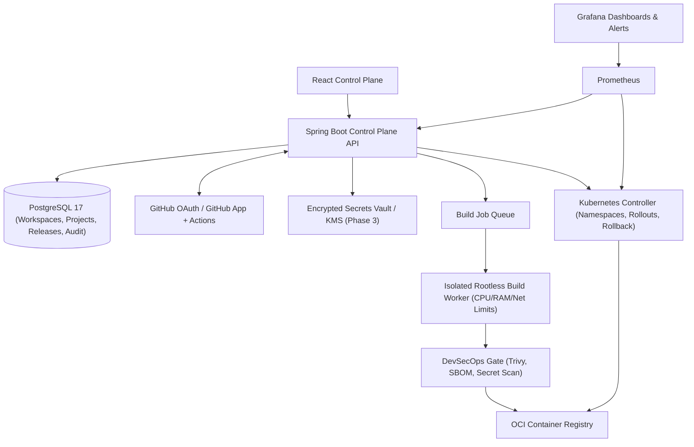

# CloudForge Architecture

This document describes the **implemented Phase 1, Phase 2 & Phases 3.1–3.3 architecture** alongside the **planned target architecture** for Phases 3.4–4. Every section explicitly distinguishes what is live today from what is planned.

---

## 1. Architectural Principles

1. **Clear Separation of Concerns:** The React control-plane UI, Java 17 Spring Boot API, PostgreSQL 17 data layer, and GitHub integration layer communicate through explicit HTTP/JSON, OAuth 2.0, GitHub App JWT, and JDBC contracts.
2. **Identity vs. Repository Authorization Separation:** GitHub OAuth 2.0 handles user identity (`read:user`, `user:email`), whereas a dedicated GitHub App handles least-privilege repository discovery (`metadata: read`) and read-only GitHub Actions telemetry (`actions: read`) via short-lived scoped installation tokens and HMAC-SHA256 verified webhooks.
3. **Defense-in-Depth & Backend-Enforced Authorization:** Every workspace-scoped API verifies server-side session authentication, CSRF tokens (for mutations), workspace membership, and RBAC roles (`OWNER`, `DEVELOPER`, `VIEWER`) on the backend — never relying on frontend visibility alone.
4. **No Arbitrary Repository Execution or Plaintext Secrets:** CloudForge persists non-secret environment configuration and declarative orchestration DAG metadata only; it never executes arbitrary shell commands, repository scripts, Docker builds, or Kubernetes jobs inside the control-plane backend.
5. **Versioned, Non-Destructive Persistence:** Flyway manages all PostgreSQL schema evolution (`ddl-auto: none` in runtime, `validate` in test profile), preserving the existing Docker volume cleanly.

---

## 2. Phases 1–3.3 Implemented Architecture

### 2.1 High-Level Component Diagram

### 2.2 Authentication, Session & CSRF Flow

1. Unauthenticated visits to any protected React route redirect to `/login`.
2. Clicking **Continue with GitHub** initiates Spring Security's standard OAuth 2.0 authorization-code flow at `/oauth2/authorization/github` with server-side `state` stored in the HTTP session (`CLOUDFORGE_SESSION`, `HttpOnly=true`, `SameSite=Lax`, configurable `Secure`).
3. On callback (`/login/oauth2/code/github`), `CloudForgeOAuth2UserService` exchanges the code server-side, upserts the user in `users`, automatically provisions a personal workspace with `OWNER` membership on first login, records a `USER_REGISTERED` / `USER_LOGIN` audit event, and stores a token-free `CloudForgeUserPrincipal` in the server-side session.
4. `OAuth2LoginSuccessHandler` validates redirect destinations strictly against `cloudforge.auth.allowed-redirect-origins` before redirecting back to the SPA.
5. All mutating browser requests (`POST`, `PUT`, `PATCH`, `DELETE`) require the `X-XSRF-TOKEN` header validated against the `XSRF-TOKEN` cookie (`SpaCsrfTokenRequestHandler` + `CsrfCookieFilter`).
6. `POST /api/auth/logout` logs `USER_LOGOUT`, invalidates the server-side `HttpSession`, clears `SecurityContext`, and expires session/CSRF cookies.
7. `GET /api/health` and `GET /actuator/health` remain publicly accessible without exposing credentials or internal details.

### 2.3 GitHub App, Actions Integration & Webhook Architecture

- **`GitHubAppTokenService`:** Loads the RSA private key (PKCS#1 or PKCS#8 PEM via BouncyCastle), signs RS256 App JWTs (9-minute lifetime, 60-second clock-drift buffer) via Nimbus JOSE+JWT, and caches short-lived installation access tokens strictly in memory keyed by `(installationId, GitHubTokenScope)` with automatic refresh/eviction across scopes.
- **`GitHubIntegrationService`:**
  - `POST /api/workspaces/{workspaceId}/github/install-url` (`OWNER` only) stores a single-use 32-byte CSPRNG `state` bound to `(workspaceId, userId)` in the HTTP session and returns the GitHub App install URL.
  - `GET /api/github/app/callback` consumes the single-use `state`, verifies `OWNER` authorization and installation ownership (enforcing strict personal account ID matching and failing closed on unverified new Organization installations until user-to-server `/user/installations` verification is added), persists `github_installations`, and synchronizes authorized repositories into `linked_repositories`.
  - Handles revoked (`404`), suspended (`403`), and rate-limited (`429` / `X-RateLimit-Remaining: 0`) GitHub responses cleanly.
- **`GitHubActionsSyncService` & `PipelineService` (Phase 3.1 Read-Only):**
  - Pull-synchronizes GitHub Actions workflows and recent runs using `ACTIONS_READ` scoped tokens (`metadata: read`, `actions: read`) outside open database transactions, persists records idempotently into `github_workflows` and `github_workflow_runs`, protects against overlapping per-repository syncs, and fetches live ordered job/step breakdowns on demand (`GET /api/workspaces/{workspaceId}/workflow-runs/{runId}/jobs`).
  - See `docs/PHASE3_1_GITHUB_ACTIONS.md` for full endpoint, RBAC, and error-handling specifications.
- **`GitHubWebhookController` & `GitHubWebhookService` (`POST /api/webhooks/github`):**
  - Reads exact raw payload bytes (`byte[]`) and verifies `X-Hub-Signature-256` with HMAC-SHA256 and `MessageDigest.isEqual` (constant-time).
  - Atomically claims `X-GitHub-Delivery` via `INSERT ... ON CONFLICT DO NOTHING` in `webhook_deliveries` prior to executing side effects so concurrent duplicate deliveries cannot duplicate state changes or abort PostgreSQL transactions.
  - Handles `ping`, `installation`, `installation_repositories`, and `repository` lifecycle events; safely ignores unsupported events (such as `push`) with `202 Accepted` without triggering builds or deployments.

### 2.4 Pipeline Orchestration Subsystem (Phase 3.2 — `com.cloudforge.backend.orchestration`)

- **`orchestration.engine`:** Pure, deterministic orchestration core containing `PipelineStateMachine`, `StageStateMachine`, `StageDagValidator` (Kahn topological sorting, cycle/missing/duplicate/command/secret validation), `StageDependencyEvaluator` (downstream readiness & failure propagation), and `WorkerAssignmentContract` (explicit internal contract for future Phase 3.3 workers).
- **`orchestration.entity` & `orchestration.repository`:** Six PostgreSQL-backed entities (`PipelineDefinitionEntity`, `PipelineStageDefinitionEntity`, `PipelineRunEntity`, `PipelineStageRunEntity`, `PipelineRunEventEntity`, `PipelineIdempotencyKeyEntity`) with encapsulated status transitions (no public `setStatus`), optimistic `@Version` row locking, pessimistic `FOR UPDATE` locking, and typed Criteria search queries.
- **`orchestration.service` & `orchestration.controller`:** `PipelineDefinitionService`, `PipelineIdempotencyService`, `PipelineOrchestrationService`, and `PipelineOrchestrationController` exposing 9 workspace-isolated RBAC REST endpoints under `/api/workspaces/{workspaceId}/pipelines`. Queued runs persist immutable definition snapshots, promote root stages to `READY`, record immutable `pipeline_run_events` and workspace `audit_events`, and remain `QUEUED` (`Queued — Awaiting execution infrastructure`) until Phase 3.3 isolated workers exist. See `docs/PHASE3_2_PIPELINE_ORCHESTRATION.md`.

### 2.5 Isolated Worker Execution Plane (Phase 3.3 — `com.cloudforge.backend.worker` & `worker/`)

CloudForge enforces strict separation between the **Control Plane** (`backend/`) and the **Execution Plane** (`worker/`):

- **Control Plane (`com.cloudforge.backend.worker`):** Manages trusted worker registration (`WorkerRegistryService`), constant-time SHA-256 worker credential authentication (`WorkerCredentialService` + stateless `@Order(1)` `WorkerAuthenticationFilter` on `/api/internal/workers/**`), bounded FIFO `READY`-stage scheduling & atomic fenced leasing (`WorkerSchedulerService`), outcome validation & DAG progression (`WorkerResultProcessorService`), expired lease fencing & crash recovery (`WorkerRecoveryService`), and defense-in-depth sanitized bounded log storage (`WorkerExecutionLogService` + `LogSanitizer`). Never executes Docker commands or mounts `/var/run/docker.sock`; disabled by default (`cloudforge.workers.enabled=false`) and locked off in `application-render.yml`.
- **Execution Plane (`worker/` — standalone `cloudforge-worker.jar`):** Runs as a separate host-side development process (`CloudForgeWorkerApplication` -> `WorkerAgentLoop` -> `HttpControlPlaneClient` -> `DockerIsolatedExecutionAdapter`). Executes ONLY compile-time allowlisted operations (`ENV_VALIDATION`, `CONTROLLED_SMOKE_TEST`, `WORKER_DIAGNOSTICS`) inside ephemeral, hardened Docker containers (`--rm`, `--user 65534:65534`, `--cap-drop=ALL`, `no-new-privileges:true`, `--read-only`, bounded `noexec` `/tmp`, `--network=none`, CPU/memory/PID limits, pinned/allowlisted images only). See `docs/PHASE3_3_ISOLATED_WORKERS.md`.

### 2.6 Encrypted Secret Management & Key Management (Phase 3.4 — `com.cloudforge.backend.secrets`)

- **Cryptographic Envelope & External Key Providers (`secrets.crypto`):** `SecretCryptoService` encrypts each secret version with a freshly generated 256-bit DEK (`AES-256-GCM`, 96-bit CSPRNG nonce, 128-bit auth tag, deterministic AAD over workspace, project, environment, secret ID, version, and format version). `SecretKeyProvider` (`EnvKeyringSecretKeyProvider` in Phase 3.4) wraps DEKs under externally supplied versioned 256-bit master KEKs with zero plaintext keys in PostgreSQL and fail-closed startup/runtime validation.
- **Lifecycle, Pipeline Pinning & Lease-Bound Worker Delivery (`secrets.service`, `secrets.controller`):** `SecretManagementService` & `EnvironmentSecretController` provide `OWNER`-restricted, write-only CRUD (`POST /secrets`, `/rotate`, `/revoke`, `DELETE`) with `Cache-Control: no-store`. `PipelineDefinitionService` and `PipelineOrchestrationService` validate per-stage secret references on approved worker stages (`SOURCE_PREP` / `TEST` allowlisted ops) within a single project target environment and pin immutable secret versions on queue without decrypting. `SecretDeliveryService` gates internal worker secret fetches on active lease, lease token, fencing generation, HTTPS/loopback opt-in, revocation status, and bounded replay limits (`workerDeliveryEnabled=false` by default). `SecretKeyRotationService` & `OperatorSecretKeyController` support operator-only DEK-only batch rewrapping across master key rotations, while `LogSanitizer`, `AttemptSecretRedactionService`, and `worker/`'s `WorkerSecretRedactor` strip leaked encoded/multiline/boundary-spanning secrets. See `docs/PHASE3_4_SECRET_MANAGEMENT.md`.

### 2.7 Backend Package Structure (`com.cloudforge.backend`)

| Package | Responsibility |
| --- | --- |
| `controller` | REST APIs (`HealthController`, `AuthController`, `WorkspaceController`, `ProjectController`, `GitHubIntegrationController`, `PipelineController`, `GitHubWebhookController`, `AuditEventController`, `SpaPageController`). |
| `service` | Domain logic (`HealthService`, `UserAccountService`, `WorkspaceAuthorizationService`, `WorkspaceService`, `ProjectService`, `ProjectEnvironmentService`, `GitHubIntegrationService`, `GitHubActionsSyncService`, `PipelineService`, `GitHubWebhookService`, `AuditService`, `AuditQueryService`). |
| `orchestration` | Phase 3.2 modular pipeline orchestration subsystem (`controller`, `service`, `engine`, `entity`, `repository`, `dto`) managing persistent pipeline definitions, DAG validation, state machines, idempotency, concurrency control, cancellation, and `WorkerAssignmentContract`. |
| `worker` | Phase 3.3 control-plane worker subsystem (`config`, `security`, `entity`, `repository`, `dto`, `service`, `controller`) handling trusted worker auth, registry, heartbeats, bounded scheduling, atomic fenced leasing, result processing, crash/lease recovery, and sanitized log persistence. |
| `secrets` | Phase 3.4 encrypted secret management (`config`, `crypto`, `entity`, `repository`, `dto`, `security`, `service`, `controller`) providing AES-256-GCM envelope encryption, `EnvKeyringSecretKeyProvider`, write-only CRUD, operator DEK rewrapping, lease-bound worker delivery, cooldown-protected audit, and defense-in-depth redaction. |
| `github` | GitHub App integration boundary (`GitHubAppTokenService`, `GitHubTokenScope`, `GitHubApiClient`, `RestClientGitHubApiClient`, `WebhookSignatureVerifier`, typed metadata DTOs & integration exceptions). |
| `security` | Spring Security filter chain, OAuth 2.0 user service, success/failure handlers, `CloudForgeUserPrincipal`, `RedirectOriginValidator`, SPA CSRF handler/filter, JSON 401/403 handlers. |
| `entity` | `BaseAuditableEntity` (UUID PK + UTC timestamps) and 11 core domain JPA entities + enums (including `GitHubWorkflowEntity`, `GitHubWorkflowRunEntity`, `WorkflowRunNormalizedStatus`). |
| `repository` | `DatabaseProbeRepository` + 11 core Spring Data JPA repositories with workspace-scoped `JOIN FETCH` and typed Criteria queries. |
| `dto` | Immutable Java 17 request/response records with Bean Validation constraints. |
| `config` | `AppProperties` (CORS, Auth, GitHub App), `WebConfig`, `RequestCorrelationFilter`. |
| `exception` | `GlobalExceptionHandler` + typed domain/integration exceptions returning structured `ApiErrorResponse` (including `409 Conflict` for optimistic locking failures). |

### 2.6 Database Schema (Flyway Migrations)

Located under `backend/src/main/resources/db/migration/`:
- **`V1__phase2_core_schema.sql`:** `users`, `workspaces`, `workspace_members`, `github_installations`, `linked_repositories`, `projects`, `project_environments`, `audit_events` with UUID primary keys, foreign keys, role/status check constraints, unique constraints, and query indexes.
- **`V2__webhook_deliveries.sql`:** `webhook_deliveries` for idempotent webhook processing and SHA-256 payload fingerprinting without storing sensitive payload bodies.
- **`V3__github_actions_workflows.sql`:** `github_workflows` and `github_workflow_runs` storing non-sensitive GitHub Actions workflow definitions and execution attempts keyed by `(linked_repository_id, github_run_id, run_attempt)`.
- **`V4__pipeline_orchestration_engine.sql`:** `pipeline_definitions`, `pipeline_stage_definitions`, `pipeline_runs`, `pipeline_stage_runs`, `pipeline_run_events`, and `pipeline_idempotency_keys` storing workspace-scoped pipeline definitions, immutable run snapshots, DAG stage instances, chronological transition events, and restart-safe idempotency claims.
- **`V5__isolated_worker_execution.sql`:** Extends `pipeline_runs` / `pipeline_stage_runs` with cancellation-intent, allowlisted operation, retry backoff, and fencing columns, and adds `worker_nodes`, `worker_credentials` (SHA-256 hashes only), `stage_execution_attempts`, and `stage_execution_logs`.
- **`V6__encrypted_secret_management.sql`:** Extends pipeline definitions, stages, runs, and attempts with target-environment and secret-binding metadata, and creates `environment_secrets`, `environment_secret_versions`, `pipeline_run_secret_references`, and `secret_key_rotation_runs`.

### 2.8 Frontend Architecture (`frontend/`)

- **Framework:** React 19, TypeScript (strict mode), Vite, React Router 7, Obsidian-inspired theme & appearance system (`PreferenceProvider` supporting Dark/Light/System themes, 5 accent palettes, density, and reduced-motion).
- **State & Auth:** `AuthContext` manages session verification (`/api/auth/me`, `/api/auth/config`), active workspace selection, role awareness, and CSRF-protected logout; `ProtectedRoute` guards authenticated views cleanly.
- **API Client (`src/services/api.ts`):** Uses `credentials: 'include'`, automatic `X-XSRF-TOKEN` header propagation on mutations, custom per-request headers (such as `Idempotency-Key`), structured `ApiClientError` handling (including `Retry-After` rate-limit parsing), and preserved Phase 1 live `/api/health` probing.
- **Live Pages:** `LoginPage`, `DashboardPage` (real project/repo counts + live health), `ProjectsPage` + `ProjectDetailPage` (CRUD + persistent non-secret environments + **Phase 3.4 write-only `EnvironmentSecretsPanel`**), `RepositoriesPage` (GitHub App installations, sync, search/filter, link to project), **`PipelinesPage` (tab-separated Phase 3.1 live GitHub Actions workflows/runs/jobs + Phase 3.2/3.3/3.4 `CloudForgePipelinesPanel` for declarative pipeline definitions, DAG stage builder, environment secret bindings, idempotent run queueing, lifecycle event inspection, worker telemetry, and cancellation)**, `SettingsPage` (profile, workspace/member RBAC, appearance, runtime status, owner audit trail), `MonitoringPage` (live `/api/health` inspector).
- **Future-Phase Blueprint Pages:** `DeploymentsPage` (Phases 3.5–3.7) remains clearly labeled as a planned capability.

---

## 3. Planned Target Architecture (Phases 3.5–4)

> **Status:** Deferred beyond Phase 3.4. Documented to guide incremental delivery.

