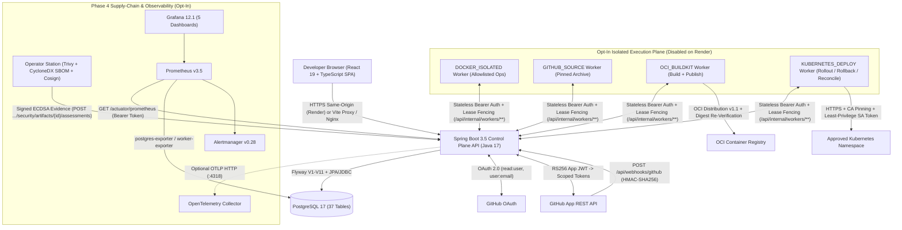

# CloudForge Architecture

This document describes the **complete implemented Phases 1–4 architecture** of CloudForge (`v1.0.0`), explicitly distinguishing between the **web control plane** (always active, including Render staging), **opt-in isolated execution planes** (local / approved environments), and **optional observability and supply-chain verification infrastructure**.

---

## 1. Architectural Principles

1. **Control-Plane / Execution-Plane Separation:** The Spring Boot control-plane backend (`backend/`) manages authentication, workspace RBAC, metadata, orchestration DAG state, encrypted secrets, release history, and audit trails. It **never** mounts `/var/run/docker.sock`, runs BuildKit, installs `kubectl`, reads kubeconfigs, or executes arbitrary repository code. All container builds, source downloads, and Kubernetes API calls run exclusively in the standalone worker agent (`worker/target/cloudforge-worker.jar`).
2. **Identity vs. Repository Authorization Separation:** GitHub OAuth 2.0 handles user identity (`read:user`, `user:email`), while a dedicated GitHub App handles least-privilege repository discovery (`metadata: read`), read-only GitHub Actions telemetry (`actions: read`), and optional operator-allowlisted source archives (`contents: read` when Phase 3.5 source acquisition is enabled) via short-lived scoped tokens and HMAC-SHA256 verified webhooks.
3. **Fail-Closed Defaults & Render Safety:** All privileged subsystems (`workers`, `source`, `secrets.worker-delivery`, `oci`, `kubernetes`, `management.tracing`) default to `false` and are explicitly locked `false` in `application-render.yml`.
4. **Immutable Artifacts & Verified Rollouts/Rollbacks:** Container deployments require verified immutable `@sha256:` OCI digests (never mutable tags), deterministic SHA-256 manifest checksum verification across backend and worker, Server-Side Apply (`force=false`), ownership-label overwrite protection, and live rollout readiness verification before recording `SUCCEEDED`.
5. **Versioned, Non-Destructive Persistence:** Flyway manages all PostgreSQL 17 schema evolution across `V1`–`V11` (37 application tables) with `ddl-auto: none` in runtime and `validate` in test verification.

---

## 2. High-Level System Architecture

---

## 3. Core Subsystems

### 3.1 Authentication, Session & CSRF Security (`security/`)
- **HTTP-only Server-Side Sessions:** Spring Security GitHub OAuth 2.0 login (`read:user`, `user:email`) creates `CLOUDFORGE_SESSION` (`HttpOnly=true`, `SameSite=Lax`, `Secure=true` in Render/HTTPS) storing a token-free `CloudForgeUserPrincipal`. GitHub access tokens never reach browser JavaScript or logs.
- **SPA CSRF Protection:** Mutating browser requests (`POST`, `PUT`, `PATCH`, `DELETE`) require `X-XSRF-TOKEN` matching the `XSRF-TOKEN` cookie (`SpaCsrfTokenRequestHandler` + `CsrfCookieFilter`).
- **Open-Redirect Protection:** `OAuth2LoginSuccessHandler` and `OAuthConfigGuardFilter` validate redirect origins strictly against `cloudforge.auth.allowed-redirect-origins`.
- **Filter Chain Isolation:** Four ordered `SecurityFilterChain` beans separate concerns cleanly:
  - `@Order(0)` `ScrapeSecurity`: `/actuator/prometheus/**` (stateless, `GET`-only, `>= 32`-char constant-time Bearer token).
  - `@Order(1)` `workerInternalSecurityFilterChain`: `/api/internal/workers/**` (stateless per-worker `X-CloudForge-Worker-Id` + SHA-256 Bearer token, fail-closed `503` when workers disabled).
  - `@Order(2)` `operatorSecretSecurityFilterChain`: `/api/internal/operator/secrets/**` (stateless operator key-rotation token, fail-closed when disabled).
  - `@Order(3)` `securityFilterChain`: Browser OAuth/session, SPA shell routes, public health probes (`/api/health`, `/actuator/health`, `/actuator/info`), and HMAC-verified `/api/webhooks/github`.

### 3.2 Workspace RBAC, GitHub App & Actions (`service/`, `github/`)
- **RBAC:** Backend-enforced `OWNER`, `DEVELOPER`, and `VIEWER` roles with strict cross-workspace isolation and last-owner protection.
- **GitHub App:** RS256 App JWT signing (`GitHubAppTokenService`), in-memory scoped installation tokens (`METADATA_READ`, `ACTIONS_READ`, `CONTENTS_READ`), single-use CSPRNG installation state validation, fail-closed new Organization installation guard, and atomic `INSERT ... ON CONFLICT DO NOTHING` webhook deduplication (`webhook_deliveries`).
- **GitHub Actions Sync (Phase 3.1):** Short-transaction pull synchronization (`GitHubActionsSyncService`) persisting `github_workflows` and `github_workflow_runs` with live job/step inspection on demand.

### 3.3 Pipeline Orchestration & Worker Execution (`orchestration/`, `worker/`, `worker/`)
- **Orchestration Engine (Phase 3.2):** Declarative DAG validation (`StageDagValidator` via Kahn topological sort rejecting cycles, shell commands, and plaintext secrets), explicit run/stage state machines, immutable definition snapshots, database-backed `Idempotency-Key` claims, and race-safe cancellation.
- **Isolated Workers (Phase 3.3):** Standalone `cloudforge-worker.jar` supporting `DOCKER_ISOLATED`, `GITHUB_SOURCE`, `OCI_BUILDKIT`, and `KUBERNETES_DEPLOY` modes. Control-plane scheduler enforces deterministic pessimistic lock ordering (`Worker -> Run -> Stage -> Attempt`), unique `leaseToken` + monotonic `fencingGeneration`, retry backoff, active cancellation, stale-lease recovery, and sanitized bounded execution logs.
- **Docker Isolation:** Allowlisted local operations (`ENV_VALIDATION`, `CONTROLLED_SMOKE_TEST`, `WORKER_DIAGNOSTICS`) execute in ephemeral containers (`--rm`, `--user 65534:65534`, `--cap-drop=ALL`, `no-new-privileges`, `--read-only`, bounded `noexec` `/tmp`, `--network=none`, CPU/memory/PID limits).

### 3.4 Encrypted Secret Management (`secrets/`)
- **Envelope Encryption (Phase 3.4):** Fresh 256-bit DEKs (`AES-256-GCM`, 96-bit CSPRNG nonces, 128-bit GCM auth tags, deterministic length-prefixed AAD binding workspace/project/environment/secret/version/format) wrapped by external versioned 256-bit KEKs (`EnvKeyringSecretKeyProvider`).
- **Controls:** `OWNER`-only write-only metadata APIs (`Cache-Control: no-store`), queue-time immutable version pinning without decrypting, lease-bound worker delivery (disabled by default, locked `false` in Render), operator DEK batch rewrapping, cooldown-throttled `SECRET_ACCESS_DENIED` audits, and multi-layer secret redaction (`LogSanitizer`, `AttemptSecretRedactionService`, `WorkerSecretRedactor`).

### 3.5 Source Acquisition, OCI Builds & Immutable Artifacts (`source/`, `oci/`)
- **Source Acquisition (Phase 3.5A):** Queue-time resolution of refs to 40-character GitHub commit SHAs, single-grant archive delivery to allowlisted `GITHUB_SOURCE` workers, bounded ZIP extraction (32 MiB ZIP / 128 MiB extracted / 12,000 entries), symlink/path-traversal rejection, and verified source handoffs.
- **OCI Builds & Publishing (Phase 3.5B):** Defensive `DockerfilePolicyValidator`, dedicated `OCI_BUILDKIT` builds producing verified local OCI Image Layout TARs (`--network=none` default, zero registry credentials during build), separate `OCI_IMAGE_PUBLISH` stage resolving encrypted registry credentials with SSRF/DNS checks and zeroing credential buffers, independent manifest SHA-256 re-verification, and `RECONCILIATION_REQUIRED` handling for interrupted publishes.

### 3.6 Kubernetes Deployment Engine, Release History & Rollback (`k8s/`)
- **Cluster & Namespace Security (Phase 3.6):** `OWNER`-only HTTPS cluster registration with explicit X.509 CA PEM pinning, operator API host allowlist + SSRF blocking, Phase 3.4 encrypted ServiceAccount tokens, worker-side `SelfSubjectAccessReview` least-privilege validation (rejecting cluster-admin), and operator-approved namespace templates (`Restricted` PSA, `ResourceQuota`, `LimitRange`, `NetworkPolicy`, namespace `Role`/`RoleBinding`).
- **Declarative Workloads:** Strictly `apps/v1 Deployment` + `v1 ClusterIP Service` consuming verified `@sha256:` artifacts, identical backend/worker SHA-256 manifest checksums, `io.kubernetes:client-java:21.0.2` with `setVerifyingSsl(true)` and `followRedirects(false)`, Server-Side Apply (`force=false`), ownership-label guard, pod diagnostics, strict readiness + digest verification, and explicit `OWNER` production approval.
- **Release History, Rollback & Reconciliation (Phase 3.7):** Monotonic target-scoped `revision_number` sequence (`DEPLOYMENT`, `ROLLBACK`, `RECONCILIATION`), structured diffs, preview-bound `expectedOperationId` preconditions, worker UID/generation preconditions, prefixed checksum fail-closed fencing, and owner-triggered read-only live cluster reconciliation.

### 3.7 Observability & DevSecOps Supply-Chain Verification (`monitoring/`, `supplychain/`, `infrastructure/monitoring/`, `infrastructure/supplychain/`)
- **Observability (Phase 4):** `OperationMetrics` records committed domain audit/OCI actions into `cloudforge_operations_total{action=...}`; `application-monitoring.yml` enables `/actuator/prometheus` (protected by `ScrapeSecurity`), HTTP latency histograms, and ECS structured JSON logs (scoped in `logback-spring.xml` under `<springProfile name="monitoring">`). `WorkerTelemetry` atomically publishes `cloudforge.prom` cross-platform for `node-exporter` scraping.
- **Signed Artifact Evidence (Phase 4):** Operator workflow (`infrastructure/supplychain/assess-image.sh`) runs Trivy vulnerability scan + CycloneDX SBOM generation + Cosign signing and produces an ECDSA-signed JSON envelope submitted to `POST /api/workspaces/{workspaceId}/security/artifacts/{artifactId}/assessments` (`OWNER` + CSRF). `ArtifactEvidenceService` verifies signatures against `cloudforge.supplychain.public-key` (raw DER Base64 or Cosign PEM), persists `artifact_security_evidence`, and enforces `requireProductionApproval` on production Kubernetes execution (failing closed if evidence is missing, >24h stale, or has any `HIGH`/`CRITICAL` finding).

---

## 4. Database Schema (Flyway Migrations `V1`–`V11`)

Located under `backend/src/main/resources/db/migration/` (37 application tables + `flyway_schema_history`):

| Migration | Tables / Changes |
| --- | --- |
| `V1__phase2_core_schema.sql` | `users`, `workspaces`, `workspace_members`, `github_installations`, `linked_repositories`, `projects`, `project_environments`, `audit_events` |
| `V2__webhook_deliveries.sql` | `webhook_deliveries` |
| `V3__github_actions_workflows.sql` | `github_workflows`, `github_workflow_runs` |
| `V4__pipeline_orchestration_engine.sql` | `pipeline_definitions`, `pipeline_stage_definitions`, `pipeline_runs`, `pipeline_stage_runs`, `pipeline_run_events`, `pipeline_idempotency_keys` |
| `V5__isolated_worker_execution.sql` | `worker_nodes`, `worker_credentials`, `stage_execution_attempts`, `stage_execution_logs` + run/stage execution columns |
| `V6__encrypted_secret_management.sql` | `environment_secrets`, `environment_secret_versions`, `pipeline_run_secret_references`, `secret_key_rotation_runs` + pipeline secret binding columns |
| `V7__container_builds_oci_registry.sql` | `GITHUB_SOURCE` worker adapter constraint + `source_archive_issued_at` |
| `V8__oci_builds_and_registry_artifacts.sql` | `oci_registry_connections`, `oci_source_handoffs`, `oci_build_records`, `oci_image_artifacts`, `oci_publish_attempts`, `oci_artifact_events` |
| `V9__kubernetes_deployment_engine.sql` | `kubernetes_cluster_connections`, `kubernetes_namespace_bindings`, `kubernetes_deployment_configs`, `kubernetes_deployment_operations`, `kubernetes_deployment_events` |
| `V10__release_history_and_rollback.sql` | `revision_number`, `operation_kind`, `restored_release_id`, `expected_operation_id`, `guard_observation_id`, `operation_reason` + artifact retention protection |
| `V11__security_evidence.sql` | `artifact_security_evidence` |

---

## 5. Deployment Topologies

1. **Local Development:** `compose.yaml` (PostgreSQL 17 + Spring Boot) + Vite dev server (`:5173`) + optional standalone `cloudforge-worker.jar`, disposable `registry:2`, disposable K3s/kind cluster, and optional `compose.monitoring.yaml`.
2. **Render Single-Origin Staging (`Dockerfile.render`):** Single non-root Java 17 container serving bundled React static assets + Spring Boot API on one HTTPS origin (`https://cloudforge-staging.onrender.com`), backed by Render PostgreSQL 17, with all execution workers and monitoring exporters disabled.
3. **Kubernetes Frontend Reference (`frontend/Dockerfile` + `infrastructure/kubernetes/frontend/frontend.yaml`):** Hardened non-root Alpine Nginx SPA container + TLS Ingress routing `/api`, `/oauth2`, `/login/oauth2` to backend and `/` to frontend.
