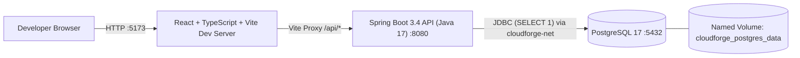
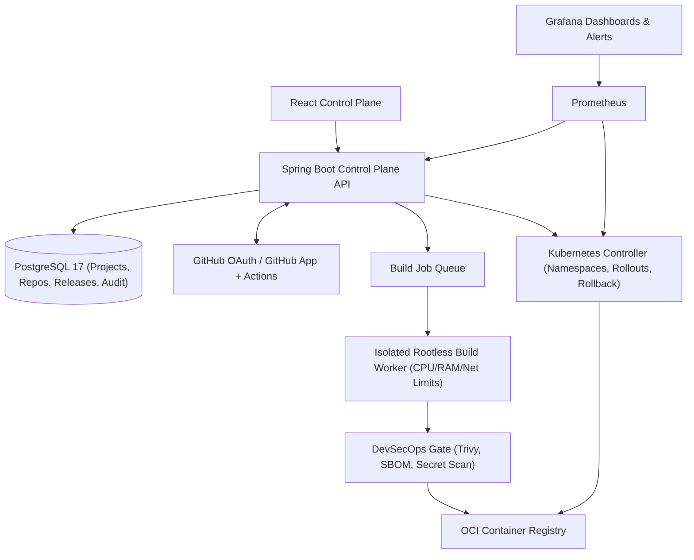

# CloudForge Architecture

This document describes the **implemented Phase 1 architecture** alongside the **planned target architecture** for Phases 2–4. Every section explicitly distinguishes what is live today from what is planned.

---

## 1. Architectural Principles

1. **Clear Separation of Concerns:** The React control-plane UI, Java 17 Spring Boot API, PostgreSQL data layer, and future infrastructure controllers are decoupled via explicit HTTP/JSON and JDBC contracts.
2. **Real Dependency Signals:** Health and readiness endpoints verify actual infrastructure dependencies (JDBC `connection.isValid` + `SELECT 1`) rather than returning hardcoded values.
3. **Security by Construction:** No secrets in Git, localhost-only local database exposure, non-root runtime containers, and strict deferral of arbitrary repository code execution until isolated build sandboxes exist.
4. **Local-First Reproducibility:** Every Phase 1 component starts locally on Windows 11 (WSL 2 + Docker Desktop), macOS, or Linux with zero paid third-party dependencies.

---

## 2. Phase 1 Implemented Architecture

### 2.1 High-Level Component Diagram

### 2.2 Frontend Architecture (`frontend/`)

- **Framework:** React 19, TypeScript (strict mode), Vite, React Router.
- **Design System:** Dark cloud-infrastructure theme built with CSS custom properties (`src/styles/tokens.css`, `src/styles/global.css`), responsive sidebar drawer (`Sidebar`), sticky top bar (`Header`), semantic badges (`StatusBadge`), modular cards (`DashboardCard`), tables (`DataTable`), and explicit `LoadingState` / `ErrorState` components.
- **API Integration:**
  - `src/services/api.ts` calls `GET /api/health` with an `AbortController` timeout and preserves HTTP `503` degraded JSON payloads instead of discarding dependency diagnostics.
  - `vite.config.ts` proxies `/api` and `/actuator` to `VITE_API_PROXY_TARGET` (default `http://localhost:8080`).
- **Pages:**
  - **Live Data Pages:** `Dashboard` and `Monitoring` display actual backend application name, status, HTTP code, PostgreSQL engine/latency, request correlation ID, and server timestamp.
  - **Phase 1 UI Foundation Pages:** `Projects`, `Repositories`, `Deployments`, `Pipelines`, and `Settings` provide the platform navigation structure and clearly labeled demonstration/blueprint states without fabricated deployment statistics.

### 2.3 Backend Architecture (`backend/`)

Structured under `com.cloudforge.backend`:

| Package | Responsibility (Phase 1) |
| --- | --- |
| `controller` | HTTP REST endpoints (`HealthController` exposing `GET /api/health`). |
| `service` | Business orchestration (`HealthService` mapping probe outcomes to `UP`/`DEGRADED` and `200`/`503`). |
| `repository` | Data access (`DatabaseProbeRepository` executing real JDBC connection validation and `SELECT 1`). |
| `entity` | JPA persistence foundation (`BaseAuditableEntity` with UUID PK and UTC timestamps ready for Phase 2 entities). |
| `dto` | Immutable Java 17 records (`HealthResponse`, `DatabaseHealthDto`, `ApiErrorResponse`). |
| `config` | Validated `AppProperties`, CORS policy (`WebConfig`), and `RequestCorrelationFilter` (`X-Request-Id` + SLF4J MDC). |
| `exception` | Centralized `GlobalExceptionHandler` returning structured JSON errors without leaking stack traces or credentials. |

### 2.4 Data & Container Architecture (`compose.yaml`, `backend/Dockerfile`)

- **PostgreSQL 17 (`postgres:17-alpine`):**
  - Persists data in named Docker volume `cloudforge_postgres_data`.
  - Runs `pg_isready` health check so the backend waits until PostgreSQL accepts connections (`depends_on: condition: service_healthy`).
  - Bound to `127.0.0.1:5432` so it is never exposed beyond localhost.
- **Spring Boot Container (`backend/Dockerfile`):**
  - Multi-stage Docker build: Stage 1 compiles and packages with `maven:3.9.9-eclipse-temurin-17-alpine`; Stage 2 runs on `eclipse-temurin:17-jre-alpine` under a non-root `cloudforge` user.
  - Connects to PostgreSQL over the internal Docker bridge network (`cloudforge-net`) using service hostname `postgres`.
  - Configured with `hikari.initialization-fail-timeout: -1` so if PostgreSQL temporarily restarts or disconnects, the API stays alive and returns an accurate `503 Service Unavailable` response until the database recovers.

---

## 3. Planned Target Architecture (Phases 2–4)

> **Status:** Not implemented in Phase 1. Documented here to guide incremental delivery.

### Planned Capabilities by Domain

- **GitHub OAuth & GitHub Apps (Phase 2):** Authenticate users via GitHub OAuth and grant repository access through per-repository GitHub App installations with short-lived tokens and HMAC-verified webhooks.
- **Domain Persistence & Flyway (Phase 2):** Versioned SQL migrations managing `users`, `projects`, `repositories`, `environments`, `deployments`, `pipeline_runs`, and `audit_events`.
- **GitHub Actions & Isolated Build Workers (Phase 3):** Synchronize workflow runs from GitHub Actions and execute container builds inside ephemeral, unprivileged build sandboxes (e.g., rootless BuildKit/Kaniko) with strict resource quotas and egress controls.
- **Docker Image Deployment, Kubernetes, History & Rollback (Phase 3):** Deploy immutable image digests into controlled Kubernetes namespaces (`infrastructure/kubernetes/`) with declarative readiness probes, persisted revision history, and one-click rollback to prior verified digests.
- **Prometheus & Grafana Observability (Phase 4):** Scrape `/actuator/prometheus`, PostgreSQL metrics, and cluster telemetry into Prometheus with provisioned Grafana dashboards and alert rules (`infrastructure/monitoring/`).
- **DevSecOps Pipeline Gates (Phase 4):** Enforce secret detection, dependency CVE checks, OCI vulnerability scanning (Trivy), SBOM generation (Syft), and Kubernetes admission policies (non-root, dropped capabilities, resource limits).
