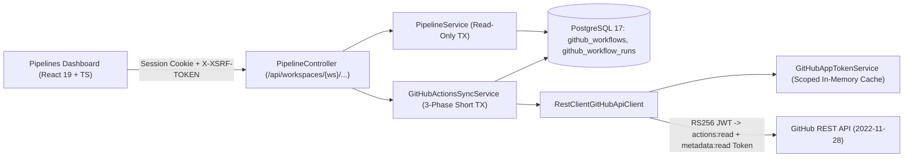

# CloudForge Phase 3.1 — Read-Only GitHub Actions Integration

> **Status:** Implemented (Phase 3.1 Read-Only Observability)  
> **Scope Boundary:** Strictly read-only GitHub Actions workflow, workflow-run, and job inspection. Does **not** dispatch workflows, execute untrusted repository code, run build workers, store plaintext/encrypted secrets, push container images, or deploy to Kubernetes (Phases 3.2–3.7 remain Planned).

---

## 1. Architecture Overview

Phase 3.1 extends CloudForge's Phase 2 GitHub App foundation with server-side, workspace-isolated GitHub Actions discovery and PostgreSQL persistence:



### Design Highlights

1. **Separated Installation Token Scopes (`GitHubTokenScope`):**
   - `REPOSITORY_METADATA` continues to request strictly `{"metadata": "read"}` for Phase 2 repository discovery, preventing installations that have not yet approved `Actions: Read` from breaking existing repository sync.
   - `ACTIONS_READ` requests strictly `{"metadata": "read", "actions": "read"}` for GitHub Actions workflow, run, and job retrieval. Zero write permissions (`actions: write`, `workflows: write`, `contents: write`, `administration`) are ever requested.
2. **Short-Transaction Sync Lifecycle (`GitHubActionsSyncService`):**
   - **Phase 1 (Read-Only Transaction):** Verifies RBAC (`OWNER`/`DEVELOPER`), GitHub App configuration, workspace repository ownership, and `ACTIVE`/`CONNECTED` status.
   - **Phase 2 (No Open DB Transaction):** Executes bounded, paginated HTTP requests against GitHub (`listRepositoryWorkflows`, `listRepositoryWorkflowRuns`) with configurable connect/read timeouts (`5s`/`10s`).
   - **Phase 3 (Write Transaction):** Idempotently upserts `github_workflows` and `github_workflow_runs`, marks removed workflows `deleted` without deleting historical runs, and writes an immutable `GITHUB_ACTIONS_SYNCED` audit event.
   - An in-memory per-repository lock (`activeRepositorySyncs`) rejects overlapping syncs on the same repository with `409 Conflict`.
3. **On-Demand Job & Step Inspection:**
   - Job and step breakdowns (`GET /repos/{owner}/{repo}/actions/runs/{run_id}/jobs`) are fetched on demand when a user inspects a run rather than persisted during bulk repository sync, avoiding N+1 GitHub API rate-limit consumption and keeping the database schema focused on workflows and runs.

---

## 2. GitHub App Permissions & Manual Configuration

### Required Repository Permissions

| Permission | Access Level | Used For |
| --- | --- | --- |
| **Metadata** | `Read-only` | Existing Phase 2 repository discovery (mandatory) |
| **Actions** | `Read-only` | Phase 3.1 workflow discovery, run history, and run job/step inspection |

All other permissions (`Contents`, `Workflows`, `Administration`, `Deployments`, `Checks`, `Pull requests`, `Issues`) remain **No access** for Phase 3.1.

### Manual Steps Required by the GitHub App Owner

CloudForge does not modify GitHub App settings automatically. To enable live GitHub Actions synchronization:

1. Open **GitHub → Settings → Developer settings → GitHub Apps → `<your CloudForge App>` → Permissions & events**.
2. Under **Repository permissions**, set **Actions** to **Read-only** (keep **Metadata** at **Read-only**).
3. Save the permission changes.
4. For every existing installation of the app, open **GitHub → Settings → Applications → Installed GitHub Apps → `<your CloudForge App>` → Review request** and approve the new **Actions: Read-only** permission.

Until an installation approves `Actions: Read`, Phase 2 repository sync (`metadata: read`) continues working normally, while Phase 3.1 workflow sync and job inspection return an actionable `403 Forbidden` permission message.

---

## 3. GitHub REST API Endpoints Supported

All requests use `Accept: application/vnd.github+json`, `X-GitHub-Api-Version: 2022-11-28`, bounded pagination, bounded timeouts, and HTTPS-only URL sanitization:

- `POST /app/installations/{installation_id}/access_tokens` — Scoped installation tokens (`metadata: read` or `metadata: read` + `actions: read`).
- `GET /repos/{owner}/{repo}/actions/workflows` — Paginated workflow discovery (bounded by `actions-sync-max-workflow-pages`, default `5` pages).
- `GET /repos/{owner}/{repo}/actions/runs` — Paginated recent workflow runs (bounded by `actions-sync-max-runs-per-repo`, default `50` runs, max `200`).
- `GET /repos/{owner}/{repo}/actions/workflows/{workflow_id}/runs` — Workflow-specific run retrieval support in the client.
- `GET /repos/{owner}/{repo}/actions/runs/{run_id}/jobs` — Ordered jobs and steps for a specific workflow run (bounded by `actions-sync-max-job-pages`, default `3` pages).

### Status Normalization (`WorkflowRunNormalizedStatus`)

CloudForge preserves GitHub's raw `githubStatus` and `githubConclusion` values and computes a normalized status without ever assuming a `completed` run succeeded:

| GitHub `status` | GitHub `conclusion` | Normalized Status |
| --- | --- | --- |
| `queued`, `requested`, `waiting`, `pending` | *(any)* | `QUEUED` |
| `in_progress` | *(any)* | `IN_PROGRESS` |
| `completed` | `success` | `SUCCESS` |
| `completed` | `failure`, `startup_failure` | `FAILURE` |
| `completed` | `cancelled` | `CANCELLED` |
| `completed` | `timed_out` | `TIMED_OUT` |
| `completed` | `skipped` | `SKIPPED` |
| `completed` / *(other)* | `null`, `neutral`, `action_required`, `stale`, unrecognized | `UNKNOWN` |

---

## 4. Database Schema (`V3__github_actions_workflows.sql`)

Existing migrations `V1__phase2_core_schema.sql` and `V2__webhook_deliveries.sql` are untouched. `V3__github_actions_workflows.sql` adds two non-destructive tables:

- **`github_workflows`**:
  - Stores workspace/repository foreign keys (`ON DELETE CASCADE`), `github_workflow_id`, `name`, `path`, `state`, sanitized `html_url` / `badge_url`, GitHub timestamps, and `last_synced_at`.
  - Unique constraint: `uq_github_workflows_repo_gh_workflow (linked_repository_id, github_workflow_id)`.
- **`github_workflow_runs`**:
  - Stores workspace/repository foreign keys (`ON DELETE CASCADE`), nullable `workflow_id` (`ON DELETE SET NULL`), `github_run_id`, `github_workflow_id`, `run_number`, `run_attempt`, `workflow_name`, `display_title`, `event`, `head_branch`, `head_sha`, `github_status`, `github_conclusion`, `normalized_status`, `actor_login`, `actor_avatar_url`, `html_url`, GitHub timestamps, and `last_synced_at`.
  - Unique constraint accounting for re-run attempts: `uq_github_workflow_runs_repo_run_attempt (linked_repository_id, github_run_id, run_attempt)`.
  - Check constraints: `run_attempt >= 1`, `run_number >= 0`, and explicit `normalized_status` enum allowlist.
  - Query indexes for workspace timeline, repository timeline, workflow timeline, status breakdown, and `(linked_repository_id, github_run_id)` lookup.

No GitHub tokens, cookies, repository secrets, or workflow environment variables are persisted.

---

## 5. Backend REST APIs & RBAC Policy

All endpoints require an authenticated session (`401` if unauthenticated) and verify workspace membership and repository/run ownership before returning data (`403` for non-members, `404` for resources outside the workspace):

| Method & Path | Allowed Roles | CSRF | Purpose |
| --- | --- | --- | --- |
| `GET /api/workspaces/{workspaceId}/pipelines` | `OWNER`, `DEVELOPER`, `VIEWER` | No | Real PostgreSQL-backed pipeline overview metrics and authorized repository summaries |
| `GET /api/workspaces/{workspaceId}/repositories/{repositoryId}/workflows` | `OWNER`, `DEVELOPER`, `VIEWER` | No | Paginated repository workflows (`q`, `state`, `page`, `size`) with latest-run summaries |
| `GET /api/workspaces/{workspaceId}/repositories/{repositoryId}/workflow-runs` | `OWNER`, `DEVELOPER`, `VIEWER` | No | Paginated repository workflow runs (`workflowId`, `status`, `branch`, `q`, `page`, `size`) |
| `GET /api/workspaces/{workspaceId}/workflow-runs` | `OWNER`, `DEVELOPER`, `VIEWER` | No | Paginated workspace-wide workflow runs (`repositoryId`, `workflowId`, `status`, `branch`, `q`, `page`, `size`) |
| `GET /api/workspaces/{workspaceId}/workflow-runs/{runId}` | `OWNER`, `DEVELOPER`, `VIEWER` | No | Full metadata for a single stored workflow run |
| `GET /api/workspaces/{workspaceId}/workflow-runs/{runId}/jobs` | `OWNER`, `DEVELOPER`, `VIEWER` | No | On-demand live read-only jobs and steps from GitHub Actions API |
| `POST /api/workspaces/{workspaceId}/repositories/{repositoryId}/workflows/sync` | `OWNER`, `DEVELOPER` | **Required** (`X-XSRF-TOKEN`) | Pull-syncs workflows and recent runs from GitHub Actions API idempotently and records an audit event |

---

## 6. Security Prerequisites & Hardening Delivered

1. **GitHub App Callback Authorization (`SEC-01`):**
   - Personal (`User`) installations strictly validate numeric `githubUserId` when provided by GitHub (`accountId > 0`), preserving compatibility with the documented personal installation flow.
   - New unverified `Organization` installations fail closed (`403 Forbidden`) because CloudForge does not request `admin:org`/`read:org` OAuth scopes or GitHub App user-to-server installation OAuth codes (`GET /user/installations`), preventing unauthorized attachment of unlinked organization installation IDs. Already-linked workspace installations remain refreshable by workspace `OWNER`s; unknown account types are rejected.
2. **Atomic Webhook Deduplication (`SEC-04`):**
   - `GitHubWebhookService` now atomically claims `webhook_deliveries.delivery_id` via `INSERT INTO webhook_deliveries ... ON CONFLICT DO NOTHING` **before** executing any side effects, preventing concurrent duplicate webhook mutations and PostgreSQL transaction-abort errors. No new webhook side effects were introduced in Phase 3.1.
3. **Environment Authorization Ordering (`SEC-03`):**
   - `ProjectEnvironmentService.updateEnvironment()` now verifies workspace membership prior to entity lookup, eliminating the 404 vs. 403 existence oracle.
4. **Root `.dockerignore` (`SEC-02`):**
   - Added a root `.dockerignore` excluding `.git/`, `.env*`, private keys (`*.pem`, `*.key`), `frontend/node_modules/`, `frontend/dist/`, and `backend/target/` from root-context container builds (`Dockerfile.render`).
5. **External Response Hygiene:**
   - All GitHub-returned `html_url`, `badge_url`, and `actor_avatar_url` values are validated to require `https://` URLs with a non-empty host; invalid or `javascript:` URLs are stripped to `null`.
   - Installation tokens and App JWTs are never persisted, logged, or returned in any API payload.

---

## 7. Error Handling Matrix

| Condition | Backend HTTP | Behavior |
| --- | --- | --- |
| Missing `Actions: Read` permission (`422` / `403` from GitHub) | `403 Forbidden` | Evicts `ACTIONS_READ` token only; leaves installation `ACTIVE`; UI shows actionable permission steps |
| GitHub rate limit (`429` or `X-RateLimit-Remaining: 0`) | `429 Too Many Requests` + `Retry-After` header | Preserves retry wait seconds; UI surfaces wait guidance |
| Revoked GitHub installation (`404` on token/installation endpoint) | `409 Conflict` | Marks installation `REVOKED` and repos `DISCONNECTED`, evicts tokens, records audit event, guides user to `/repositories` |
| Suspended GitHub installation (`403` suspended) | `409 Conflict` | Marks installation and repos `SUSPENDED`, evicts tokens, records audit event |
| Missing/inaccessible repository (`404` on `/repos/.../actions/*`) | `404 Not Found` | Marks only that repository `DISCONNECTED` (leaving sibling repos intact) and records audit event |
| Concurrent sync already running for repository | `409 Conflict` | Rejects overlapping sync safely without corrupting stored rows |

---

## 8. Configuration & Local Verification

Optional tuning environment variables (all have safe defaults in `application.yml`):

| Variable | Default | Purpose |
| --- | --- | --- |
| `GITHUB_API_CONNECT_TIMEOUT_SECONDS` | `5` | Bounded HTTP connect timeout for GitHub API |
| `GITHUB_API_READ_TIMEOUT_SECONDS` | `10` | Bounded HTTP read timeout for GitHub API |
| `GITHUB_ACTIONS_SYNC_MAX_WORKFLOW_PAGES` | `5` | Max workflow pages fetched per sync |
| `GITHUB_ACTIONS_SYNC_MAX_RUNS_PER_REPO` | `50` | Max recent workflow runs fetched per sync (capped at `200`) |
| `GITHUB_ACTIONS_SYNC_PER_PAGE` | `50` | Page size for GitHub Actions REST requests (capped at `100`) |
| `GITHUB_ACTIONS_SYNC_MAX_JOB_PAGES` | `3` | Max job pages fetched per run inspection |

### Verification Commands

```bash
# Backend
cd backend
mvn -B test
mvn -B package -DskipTests

# Frontend
cd frontend
npm ci
npm run typecheck
npm test
npm run build

# Docker Compose validation
docker compose config --quiet
```

---

## 9. Known Limitations & Planned Next Phases

### Current Limitations (Phase 3.1)

- **Pull-Based Synchronization Only:** Users trigger synchronization via `Sync from GitHub`; automatic `workflow_run` webhook ingestion is deferred to keep Phase 3.1 strictly pull-based and predictable.
- **Organization Installation Linking Blocked Pending User-to-Server OAuth:** New GitHub Organization App installations fail closed on callback until GitHub App user-to-server OAuth (`Request user authorization (OAuth) during installation` + `GET /user/installations`) is configured and implemented.
- **No Log or Artifact Downloads:** Job/step statuses and GitHub deep-links are displayed, while raw log streaming and artifact downloads are intentionally excluded in this milestone.
- **In-Memory Concurrency Lock & Token Cache:** Single-instance `ConcurrentHashMap` locks and installation token caches are suitable for single-node deployments; multi-replica deployments will require distributed coordination in a later phase.

### Explicitly Planned (Not Yet Implemented)

- **Phase 3.2:** Pipeline orchestration engine & durable job queues
- **Phase 3.3:** Isolated rootless container build workers
- **Phase 3.4:** Encrypted secret management (KMS / envelope encryption)
- **Phase 3.5:** OCI container registry publishing & digest provenance
- **Phase 3.6:** Kubernetes deployment engine
- **Phase 3.7:** Deployment release history & rollback
