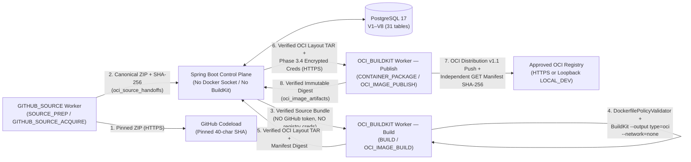

# CloudForge Phase 3.5 — Secure Container Builds, OCI Registry Publishing & Immutable Artifact Management

Phase 3.5 delivers end-to-end **immutable GitHub source acquisition (Phase 3.5A)**, **bounded BuildKit OCI image construction**, **standards-based OCI Distribution v1.1 registry publishing with Phase 3.4 encrypted credential references**, **independent immutable SHA-256 digest verification**, and **persistent artifact management (Phase 3.5B)**.

> **Trust Boundary & Scope Notice:** CloudForge Phase 3.5 supports **operator-approved repositories and trusted local/dedicated BuildKit workers only**. Standard container or Docker BuildKit builds are **not** presented as sufficient isolation for hostile multi-tenant repositories; hostile multi-tenant execution requires kernel/microVM sandboxing (e.g., gVisor, Kata Containers, or Firecracker) in a future milestone. All worker and OCI execution flags remain **disabled by default** (`false`) and locked `false` in `application-render.yml`.

---

## 1. Three-Stage Cryptographic Isolation Architecture

CloudForge separates source acquisition, Dockerfile execution, and registry publishing into three distinct, lease-fenced stages so no single worker stage holds both repository credentials/untrusted Dockerfile execution and registry push credentials:

### Stage-by-Stage Security Guarantees

1. **Stage 1 — `SOURCE_PREP` (`GITHUB_SOURCE_ACQUIRE`, `GITHUB_SOURCE` worker):**
   - Resolves the branch/tag at queue time to an immutable 40-character commit SHA against the immutable GitHub repository ID.
   - Issues at most one scoped `codeload.github.com` archive URL per leased, fenced attempt over HTTPS (`Cache-Control: no-store`).
   - Validates ZIP directory, rejects symlinks, special files, path traversal, `.git`, and size/entry overflows (32 MiB ZIP, 128 MiB extracted, 12,000 entries).
   - When the run contains an `OCI_IMAGE_BUILD` stage and `CLOUDFORGE_OCI_ENABLED=true`, packages a deterministic canonical ZIP (`GitHubSourceArchive.packageCanonicalZip`), uploads it with its SHA-256 digest to `POST /api/internal/workers/{workerId}/attempts/{attemptId}/source-handoff` (bound to workspace, project, run, stage, attempt, repository ID, commit SHA, and SHA-256), and deletes all local temporary files.
2. **Stage 2 — `BUILD` (`OCI_IMAGE_BUILD`, `OCI_BUILDKIT` worker, `idempotent=true`):**
   - **Never receives GitHub tokens or OCI registry credentials** (`hasRegistryCredentials=false`; `POST .../registry-credentials` returns `403 Forbidden` for `OCI_IMAGE_BUILD`).
   - Downloads the verified source handoff, verifies exact SHA-256 checksum, extracts safely, and runs `DockerfilePolicyValidator`.
   - Runs BuildKit (`docker buildx` or rootless `buildctl`) via `ProcessBuilder` argument arrays (never a host shell) with `--output type=oci,dest=...`, `--no-cache`, `--provenance=false`, `--sbom=false`, `--network=none` by default, zero privileged/host-network/SSH/secret entitlements, worker credentials stripped from child environment, bounded timeout, and active cancellation process-tree termination.
   - Verifies every blob (`oci-layout`, `index.json`, manifest, config, and all layers) via `OciLayoutInspector`, stages the bounded OCI Image Layout TAR (`POST .../oci-layout-upload`), and records `oci_build_records`.
   - Cannot mark `SUCCEEDED` until a matching `oci_build_records` row with valid `sha256:...` digest is persisted.
3. **Stage 3 — `CONTAINER_PACKAGE` (`OCI_IMAGE_PUBLISH`, `OCI_BUILDKIT` worker, `idempotent=false`):**
   - **Never executes Dockerfile instructions.**
   - Downloads the verified OCI Image Layout TAR from Stage 2 and validates every blob digest locally.
   - Fetches workspace registry credentials strictly through CloudForge's Phase 3.4 AES-256-GCM envelope-encrypted secret subsystem (`POST .../registry-credentials` over HTTPS with `Cache-Control: no-store`, bounded delivery count, active lease + fencing verification).
   - Holds credentials strictly in memory (`char[]`/`byte[]`), zeroes buffers in `finally`, disables HTTP redirects (`Redirect.NEVER`), enforces SSRF IP/DNS checks on both registry host and Bearer token `realm`, and pushes blobs + manifest via `OciRegistryClient` (pure Java 17 OCI Distribution Specification v1.1).
   - Independently executes `GET /v2/<repository>/manifests/<digest>`, computes raw SHA-256 over the returned manifest bytes, and asserts `computedDigest == reportedDigest == expectedBuildDigest`.
   - Persists `oci_publish_attempts`, idempotent `oci_image_artifacts` (unique on workspace + run + registry host + image repository + digest), and chronological `oci_artifact_events`.
   - **Retry safety:** Because publishing is non-idempotent (`idempotentOperation=false`), expired publish leases are marked `RECONCILIATION_REQUIRED` and never blindly auto-redispatched.

---

## 2. Declarative Build Configuration & Policy Validation

### Control-Plane Build Request Validation (`BuildRequestValidator`)
Validated on pipeline definition create/update and re-validated on run queue & worker descriptor resolution:
- `dockerfilePath` (default `Dockerfile`) and `buildContextPath` (default `.`): safe relative paths only; rejects `/`, `\`, `~`, `..`, `.git`, wildcards, control chars, `http://`, `https://`, `git://`, `docker://`, `unix:`, `tcp:`.
- `registryConnectionId`: must reference an `ACTIVE` registry connection belonging to the same workspace and passing current operator host/SSRF policy.
- `targetImageName`: lowercase OCI path strictly inside the registry connection's `allowedNamespace`.
- `targetTag` (optional): validated OCI tag (`^[A-Za-z0-9_][A-Za-z0-9._-]{0,127}$`).
- `targetPlatform`: restricted to `CLOUDFORGE_OCI_ALLOWED_PLATFORMS` (default `linux/amd64,linux/arm64`).
- `buildMode`: `ROOTLESS_BUILDKIT` or `LOCAL_TRUSTED_BUILDKIT` (rejects privileged modes).
- `buildArg.*`: up to 5 non-secret build args; rejects keys/values matching secret/token/password/socket/docker-host patterns.
- Direct Phase 3.4 stage secret bindings (`secretBindings`) are blocked on `OCI_IMAGE_BUILD` and `OCI_IMAGE_PUBLISH` stages (registry credentials come strictly from the workspace registry connection's encrypted secret references).

### Worker Dockerfile & Context Policy Validation (`DockerfilePolicyValidator`)
> **Defense-in-Depth Note:** Static Dockerfile parsing is a defensive gate only and is **not** a substitute for execution sandboxing.

Validates:
- Context and Dockerfile resolve strictly inside the verified extracted source root with no symlinks or special files.
- Bounded Dockerfile size (1 B – 64 KiB) and build context bounds (<= 12,000 files, <= 128 MiB).
- `#syntax=` directives restricted to official `docker/dockerfile:1*` frontends.
- `FROM` base images restricted to the curated allowlist (`scratch`, `alpine:3.20`, `alpine:3.21`, `busybox:1.36`, `gcr.io/distroless/static-debian12`, `gcr.io/distroless/base-debian12`, `eclipse-temurin:17-jre-alpine`, `node:20-alpine`, `node:22-alpine`, `nginx:1.27-alpine`, plus optional operator-configured `CLOUDFORGE_OCI_ALLOWED_BASE_IMAGES`). Dynamic `${VAR}` in `FROM` is rejected.
- Rejects remote `ADD` URLs, `RUN --security=insecure`, `RUN --network=host`, `RUN --mount=type=ssh|secret`, external `RUN --mount=type=bind,from=...`, external `COPY --from=<image>`, `ONBUILD`, `VOLUME`, and secret-like `ARG`/`ENV` declarations.

---

## 3. Database Schema (`V8__oci_builds_and_registry_artifacts.sql`)

Non-destructive migration preserving `V1`–`V7` untouched (total: **31 application tables** across 8 Flyway migrations):
- Extends `worker_nodes.ck_worker_nodes_adapter` with `OCI_BUILDKIT`.
- Extends `stage_execution_attempts.ck_stage_attempts_failure_category` with `DOCKERFILE_POLICY_VIOLATION`, `SOURCE_CONTEXT_INVALID`, `BUILD_FAILED`, `REGISTRY_AUTH_FAILED`, `REGISTRY_UNAVAILABLE`, `DIGEST_VERIFICATION_FAILED`.
- Creates 6 new tables:
  1. `oci_registry_connections` — workspace-scoped approved registry destinations storing **only** foreign keys to Phase 3.4 `environment_secrets` (never plaintext credentials).
  2. `oci_source_handoffs` — ephemeral, TTL-bounded, SHA-256-verified `SOURCE_CONTEXT` and `OCI_IMAGE_LAYOUT` handoff records cleaned automatically on expiry and terminal/cancelled runs.
  3. `oci_build_records` — persistent build configuration snapshots, config checksums, Dockerfile/context paths, target platform/mode, BuildKit outcome, and built manifest digest.
  4. `oci_image_artifacts` — immutable digest-verified container image records (`registry_host`, `image_repository`, `image_tag`, `manifest_digest`, `immutable_reference`, `platform`, `commit_sha`, `verification_status`, `retention_policy`).
  5. `oci_publish_attempts` — per-attempt publish audit log tracking expected vs. reported vs. independently verified digest and `RECONCILIATION_REQUIRED` states.
  6. `oci_artifact_events` — chronological lifecycle audit events for builds, publishes, verifications, and failures.

---

## 4. REST API Surface

### Workspace-Scoped User APIs (Session Auth + Workspace Isolation; CSRF on Mutations)
| Method & Path | Role | Purpose |
| --- | --- | --- |
| `GET /api/workspaces/{workspaceId}/oci/status` | Member | Honest OCI subsystem enabled status, allowlisted hosts/platforms, active `OCI_BUILDKIT` workers, and counts |
| `GET /api/workspaces/{workspaceId}/registries` | Member | List workspace OCI registry connections (metadata & secret reference names only; `Cache-Control: no-store`) |
| `GET /api/workspaces/{workspaceId}/registries/{registryId}` | Member | Get single registry connection metadata |
| `POST /api/workspaces/{workspaceId}/registries` | `OWNER` | Create SSRF-validated registry connection referencing Phase 3.4 encrypted secrets |
| `PUT /api/workspaces/{workspaceId}/registries/{registryId}` | `OWNER` | Update registry connection metadata/secret references |
| `POST /api/workspaces/{workspaceId}/registries/{registryId}/disable` | `OWNER` | Disable registry connection |
| `GET /api/workspaces/{workspaceId}/builds` | Member | Paginated OCI build history (`projectId`, `status`, `q`) |
| `GET /api/workspaces/{workspaceId}/artifacts` | Member | Paginated immutable image artifacts (`projectId`, `verificationStatus`, `q`) |
| `GET /api/workspaces/{workspaceId}/artifacts/{artifactId}` | Member | Detailed immutable artifact record with linked build record, publish attempts, and lifecycle events |
| `GET /api/workspaces/{workspaceId}/pipelines/runs/{runId}/artifacts` | Member | Builds and verified immutable artifacts produced by a specific pipeline run |

### Internal Worker Endpoints (`ROLE_TRUSTED_WORKER` Stateless Auth Only)
All under `/api/internal/workers/{workerId}/attempts/{attemptId}/`:
- `POST /source-handoff` (`GITHUB_SOURCE` only, after `/source-archive` grant)
- `POST /oci-descriptor` (`OCI_BUILDKIT` only)
- `POST /build-context` (`OCI_BUILDKIT` `OCI_IMAGE_BUILD` only)
- `POST /oci-layout-upload` (`OCI_BUILDKIT` `OCI_IMAGE_BUILD` only)
- `POST /build-result` (`OCI_BUILDKIT` `OCI_IMAGE_BUILD` only)
- `POST /oci-layout-download` (`OCI_BUILDKIT` `OCI_IMAGE_PUBLISH` only)
- `POST /registry-credentials` (`OCI_BUILDKIT` `OCI_IMAGE_PUBLISH` only; HTTPS required unless explicit local opt-in; `Cache-Control: no-store`)
- `POST /publish-result` (`OCI_BUILDKIT` `OCI_IMAGE_PUBLISH` only)

---

## 5. Configuration & Render Safety Defaults

All execution flags default to `false` and are locked `false` in `backend/src/main/resources/application-render.yml`:

| Variable | Default | Purpose |
| --- | --- | --- |
| `CLOUDFORGE_OCI_ENABLED` | `false` | Master switch for Phase 3.5B OCI build & publish scheduling/endpoints |
| `CLOUDFORGE_OCI_ALLOW_LOCAL_DEV_REGISTRY` | `false` | Explicit opt-in allowing loopback `LOCAL_DEV` registries (`127.0.0.1` / `localhost`) |
| `CLOUDFORGE_OCI_ALLOW_INSECURE_LOCAL_CREDENTIAL_DELIVERY` | `false` | Explicit loopback-only HTTP override for local dev testing of `/registry-credentials` |
| `CLOUDFORGE_OCI_ALLOWED_REGISTRY_HOSTS` | `""` | Comma-separated allowlist of approved registry `host[:port]` destinations (e.g. `127.0.0.1:5000,ghcr.io`) |
| `CLOUDFORGE_OCI_ALLOWED_WORKER_IDS` | `""` | Comma-separated allowlist of approved `OCI_BUILDKIT` worker IDs |
| `CLOUDFORGE_OCI_ALLOWED_PLATFORMS` | `linux/amd64,linux/arm64` | Approved target OCI platforms |
| `CLOUDFORGE_WORKER_OCI_BUILDKIT_ENABLED` | `false` | Enables `OCI_BUILDKIT` mode on standalone `cloudforge-worker.jar` (mutually exclusive with `CLOUDFORGE_WORKER_SOURCE_ONLY`) |
| `CLOUDFORGE_OCI_BUILDKIT_DRIVER` | `buildx` | BuildKit driver (`buildx` or `buildctl`) |
| `CLOUDFORGE_OCI_BUILDKIT_BUILDER` | `""` | Optional named BuildKit builder (blank uses active default builder) |
| `CLOUDFORGE_OCI_BUILDKIT_ADDR` | `""` | Optional rootless `buildkitd` socket/addr when using `buildctl` |
| `CLOUDFORGE_OCI_ALLOW_BUILD_NETWORK` | `false` | Keeps `--network=none` during Dockerfile builds unless explicitly opted in |
| `CLOUDFORGE_OCI_ALLOW_LOCAL_DEV_REGISTRY_WORKER` | `false` | Worker-side opt-in allowing loopback `LOCAL_DEV` registry pushes |
| `CLOUDFORGE_OCI_ALLOWED_BASE_IMAGES` | `""` | Optional extra allowlisted base image references |

---

## 6. Local Verification & Known Limitations

### Local End-to-End Verification Runbook
1. Start PostgreSQL 17 and a disposable local OCI registry (`docker run -d --rm -p 127.0.0.1:5000:5000 registry:2`).
2. Start `cloudforge-backend` with `CLOUDFORGE_WORKERS_ENABLED=true`, `CLOUDFORGE_WORKERS_SCHEDULER_ENABLED=true`, `CLOUDFORGE_SECRETS_ENABLED=true` (with external KEK), `CLOUDFORGE_SOURCE_ACQUISITION_ENABLED=true`, `CLOUDFORGE_OCI_ENABLED=true`, `CLOUDFORGE_OCI_ALLOW_LOCAL_DEV_REGISTRY=true`, `CLOUDFORGE_OCI_ALLOWED_REGISTRY_HOSTS=127.0.0.1:5000`, and provisioned worker credentials for both a `GITHUB_SOURCE` worker and an `OCI_BUILDKIT` worker.
3. Start the dedicated `GITHUB_SOURCE` worker (`CLOUDFORGE_WORKER_SOURCE_ONLY=true`) and dedicated `OCI_BUILDKIT` worker (`CLOUDFORGE_WORKER_OCI_BUILDKIT_ENABLED=true`, `CLOUDFORGE_OCI_ALLOW_LOCAL_DEV_REGISTRY_WORKER=true`).
4. In the **Pipelines → Builds & Artifacts** tab, configure the approved `LOCAL_DEV` registry connection (referencing Phase 3.4 encrypted secrets if authenticated).
5. In **Pipelines → CloudForge Pipelines**, create a 3-stage DAG (`GITHUB_SOURCE_ACQUIRE` → `OCI_IMAGE_BUILD` → `OCI_IMAGE_PUBLISH`) and queue a run.
6. Verify the persisted build record, verified immutable `registry/repo@sha256:...` artifact, publish attempt audit, and event timeline in both the **Run Details** modal and **Builds & Artifacts** tab.

### Verified Execution Evidence (Phase 3.5B)
- **PostgreSQL 17.12 (`postgres:17-alpine`):** Flyway cleanly applied `V1`–`V8` creating 31 application tables; backend suite passed **80/80 tests (0 failed, 0 skipped)** including all 6 live PostgreSQL regression tests covering `oci_registry_connections`, `oci_build_records`, and `oci_image_artifacts` search queries.
- **Real Docker 29.8.0 + BuildKit v0.33.0 + Disposable `registry:2`:** Worker suite passed **28/28 tests (0 failed, 0 skipped)** including:
  - `RealBuildKitAndRegistryEndToEndTest`: built a real `FROM scratch` OCI image with `docker buildx build --output type=oci --network none`, inspected all layout blobs with `OciLayoutInspector`, published to a live disposable `registry:2` container via `OciRegistryClient`, and independently retrieved & verified the raw manifest SHA-256 (`127.0.0.1:<port>/cloudforge/e2e-hello@sha256:2a41e48b858a522215c27a0ba1653d9a282609aca3076acb88bcbb08b0a9a54a`, 1254 bytes).
  - `DockerIsolatedExecutionIntegrationTest`: verified real hardened `alpine:3.20` non-root read-only containers and timeout/cancellation termination.
- **Frontend:** `npm ci` (0 vulnerabilities), `npm run typecheck`, `npm test` (**31/31 tests passed across 6 files**), and `npm run build` all succeeded.
- **Packaging & Compose:** `cloudforge-backend.jar`, `cloudforge-worker.jar`, `frontend/dist/`, and `docker compose -f compose.yaml config --quiet` all verified cleanly.

### Known Limitations & Future Hardening
- **Hostile multi-tenant isolation:** Standard Docker BuildKit / rootless BuildKit is suitable only for trusted/operator-approved repositories; hostile multi-tenant builds require microVM isolation (Firecracker / Kata / gVisor) before lifting the repository allowlist.
- **External registries (GHCR / Docker Hub / ECR):** Fully supported over HTTPS + Bearer/Basic OCI Distribution v1.1 protocol, but live remote publishing requires operator-supplied external registry credentials and host allowlisting (not executed automatically in CI).
- **Private GitHub App source downloads:** End-to-end private repository ZIP acquisition requires a live GitHub App installation with `Contents: Read-only` permission; automated backend tests cover the exact API and security contract using mocked GitHub responses.
- **Next milestones:** Phase 3.6 (Kubernetes orchestration), Phase 3.7 (Deployment history & rollback), Phase 4 (Observability, Trivy/SBOM/Cosign DevSecOps gates).
