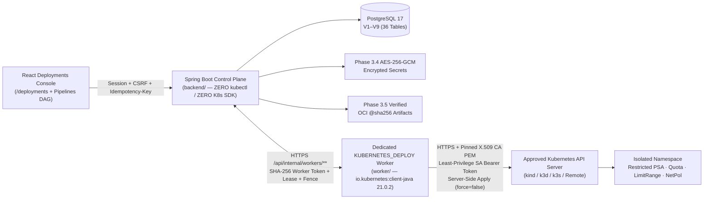

# CloudForge Phase 3.6 — Secure Kubernetes Deployment Engine, Cluster Integration & Rolling Updates

This document specifies the implemented **Phase 3.6 Secure Kubernetes Deployment Engine** for CloudForge, covering control-plane / execution-plane separation, cluster registration & validation, least-privilege Kubernetes RBAC, namespace isolation, deterministic manifest generation, verified immutable OCI digest integration, rolling update monitoring, health verification, cancellation & crash reconciliation, PostgreSQL `V9` persistence, REST APIs, premium frontend console, local cluster provisioning, security limitations, automated/live test results, and the boundary with future **Phase 3.7 Rollback**.

> **Scope & Honesty Notice:** Phase 3.6 implements verified, immutable-digest Kubernetes `apps/v1 Deployment` + `v1 ClusterIP Service` rolling updates for local (`kind`, `k3d`, `k3s`) and operator-approved remote clusters. **Full release rollback is NOT implemented in Phase 3.6** — Phase 3.6 persists immutable release evidence (commit SHA, `@sha256:` image digest, manifest SHA-256 checksum, config snapshot, Kubernetes UIDs, actor, and rollout outcome) strictly as the foundation for **Phase 3.7**.

---

## 1. Deployment Architecture & Control-Plane / Execution-Plane Boundary

CloudForge extends its established **Phase 3.2** DAG orchestration engine, **Phase 3.3** isolated worker leasing/fencing framework, **Phase 3.4** AES-256-GCM encrypted secret vault, and **Phase 3.5** immutable verified OCI image artifacts — without introducing a second scheduler.



### Strict Security Boundaries

- **Zero Kubernetes Client in Public Web Server / Render:** `io.kubernetes:client-java` exists **only** in `worker/pom.xml`, never in `backend/pom.xml`. The Spring Boot control plane never runs `kubectl`, never mounts kubeconfig files, and never connects to Kubernetes API servers.
- **Fail-Closed Safe Defaults & Render Protection:** `CLOUDFORGE_K8S_ENABLED`, `CLOUDFORGE_K8S_ALLOW_LOCAL_DEV_CLUSTERS`, `CLOUDFORGE_K8S_ALLOW_PRODUCTION_DEPLOYMENTS`, and `CLOUDFORGE_K8S_ALLOW_INSECURE_LOCAL_CREDENTIAL_DELIVERY` all default to `false` and are explicitly locked to `false` in `backend/src/main/resources/application-render.yml`.
- **Dedicated Worker Capability Boundary:** Only operator-allowlisted (`CLOUDFORGE_K8S_ALLOWED_WORKER_IDS`) workers running with `CLOUDFORGE_WORKER_KUBERNETES_DEPLOY_ENABLED=true` may register with `adapterType=KUBERNETES_DEPLOY` and `supportedOperations=[KUBERNETES_DEPLOY]` (`maxConcurrency <= 2`). Mutually exclusive with `GITHUB_SOURCE` and `OCI_BUILDKIT`:
  - Build workers and source workers never receive Kubernetes credentials.
  - Kubernetes deployment workers never execute Dockerfiles and never receive GitHub App private keys.

---

## 2. Cluster Connection Management & Credential Security

Cluster connections are stored per workspace in `kubernetes_cluster_connections` (`OWNER`-only registration/modification):

- **Supported Cluster Types:** `KIND_LOCAL`, `K3D_LOCAL`, `K3S_LOCAL`, `REMOTE_KUBERNETES`.
- **Transport & Endpoint Validation (`ClusterSecurityValidator`):**
  - Strictly requires `https://` URLs (plaintext HTTP, embedded userinfo, query strings, and fragments are rejected).
  - Requires operator host allowlisting (`CLOUDFORGE_K8S_ALLOWED_API_HOSTS`).
  - Blocks cloud metadata endpoints (`169.254.169.254`, `metadata.google.internal`, `100.100.100.200`, `fd00:ec2::254`, `*.internal`, `*.local`), link-local, multicast, and RFC1918 private addresses against SSRF.
  - Isolates local loopback endpoints (`127.0.0.1`, `localhost`, `::1`) behind three explicit guards: local cluster type (`KIND_LOCAL`/`K3D_LOCAL`/`K3S_LOCAL`), per-cluster `allowLocalLoopback=true`, and operator flag `CLOUDFORGE_K8S_ALLOW_LOCAL_DEV_CLUSTERS=true`.
- **Public X.509 CA Pinning:** Requires a valid PEM-encoded X.509 CA certificate bundle (up to 8 certs), computes its SHA-256 fingerprint, and actively rejects private keys or kubeconfig content (`PRIVATE KEY`, `client-key-data`, `kubeconfig`).
- **Encrypted ServiceAccount Credentials:** Reuses Phase 3.4 `environment_secrets` (AES-256-GCM envelope encryption). Plaintext bearer tokens and administrator kubeconfigs are never stored in `kubernetes_cluster_connections` or exposed to browser JavaScript.
- **Worker-Side Cluster Validation (`KubernetesClusterValidator`):**
  - `POST /api/workspaces/{workspaceId}/clusters/{clusterId}/validate` transitions the cluster to `VALIDATING` with a monotonic `validation_nonce`.
  - A dedicated `KUBERNETES_DEPLOY` worker claims the validation task, fetches decrypted credentials strictly over HTTPS (or explicit local-dev loopback opt-in) with `Cache-Control: no-store`, and verifies:
    1. Live TLS handshake against the pinned CA PEM (`setVerifyingSsl(true)` unconditionally; redirects disabled).
    2. Kubernetes API `/version` reachability.
    3. `apps/v1` API group availability.
    4. Least-privilege identity via `SelfSubjectAccessReview` — **explicitly rejects over-privileged `cluster-admin` / `clusterrolebindings create` / `*/*/*` credentials**.
    5. Required namespace RBAC (`deployments`, `services`, `pods`, `replicasets`, `events`), absence of `secrets` read access, and namespace existence.

---

## 3. Namespace Isolation & NetworkPolicy Enforcement

- **Deterministic Naming:** `cf-<workspaceShortId8>-<projectSlug>-<dev|stg|prod>` (DNS-1123 compliant, `<= 63` characters).
- **Reserved Namespace Blocking:** Strictly prohibits `default`, `kube-system`, `kube-public`, `kube-node-lease`, `kube-*`, `openshift-*`, `k8s-*`, `ingress-nginx`, `cert-manager`, `istio-system`, `calico-system`, `tigera-operator`, and cloud control-plane namespaces in both backend and worker validators.
- **Operator-Provisioned Bindings (`kubernetes_namespace_bindings`):** Deployment workers never receive cluster-wide namespace creation permissions. Operators provision isolated namespaces ahead of time using `infrastructure/kubernetes/local/provision-local-namespace.{sh,ps1}` applying:
  - Pod Security Admission (`pod-security.kubernetes.io/enforce: restricted`).
  - `ResourceQuota` (`pods: 20`, CPU/memory caps, `services.loadbalancers: 0`, `services.nodeports: 0`).
  - `LimitRange` (container min/default/max CPU & memory).
  - Default-deny ingress & egress `NetworkPolicy` plus narrowly scoped DNS (port 53 to `kube-system/kube-dns`) and same-namespace ingress rules.
- **CNI Enforcement Caveat:** `NetworkPolicy` resources only block traffic when a policy-enforcing CNI is installed (e.g., K3s `kube-router`, Calico, Cilium). Default `kind` (`kindnet`) does not enforce `NetworkPolicy`; bindings distinguish `DEFAULT_DENY`, `ENFORCED_VERIFIED`, and `UNENFORCED_LOCAL_CNI`.

---

## 4. Least-Privilege Kubernetes RBAC

Version-controlled templates live under `infrastructure/kubernetes/rbac/`:

- **`cloudforge-deployer` (`ServiceAccount` + namespace-scoped `Role` + `RoleBinding`):**
  - Permitted: `apps/deployments` (`get`, `list`, `create`, `update`, `patch`), `apps/replicasets` (`get`, `list`), `services` (`get`, `list`, `create`, `update`, `patch`), `pods` & `events` (`get`, `list`).
  - Prohibited: `secrets`, `roles`, `rolebindings`, `serviceaccounts`, `namespaces`, `clusterroles`, `clusterrolebindings`, and any access outside the bound namespace (`kube-system`, `default`, unrelated tenant namespaces).
- **`cloudforge-workload` (`ServiceAccount`):** Assigned to deployed application pods with `automountServiceAccountToken: false` and zero RBAC bindings.
- **Documented RBAC Boundary:** Kubernetes RBAC `create` on `apps/deployments` cannot by itself restrict container security fields or enforce immutable image digests. CloudForge enforces defense-in-depth through namespace Restricted Pod Security Admission, `ResourceQuota`/`LimitRange`, deterministic control-plane + worker manifest generation/checksum verification, Server-Side Apply (`force=false`), and ownership-label verification before writes.

---

## 5. Declarative Workload Model, OCI Integration & Hardened Manifests

- **Supported Resource Scope (v1):** Strictly `apps/v1 Deployment` + `v1 ClusterIP Service`. Arbitrary user YAML submissions are prohibited.
- **Verified Phase 3.5 OCI Artifact Enforcement:** Before queueing a deployment, `KubernetesDeploymentService` verifies user auth, workspace membership, project ownership, environment ownership, `VALIDATED` cluster status, `ACTIVE` namespace binding, artifact workspace/project ownership, `verificationStatus == VERIFIED`, and strict immutable digest format (`<registry>/<repo>@sha256:<64-hex>`). Mutable tags (`:latest`, `:v1`) are rejected at both backend and worker layers, and referenced artifacts are promoted to `REFERENCED_PROTECTED`.
- **Declarative Validation (`KubernetesDeploymentConfigValidator`):**
  - Replicas bounded `1..maxReplicas` (default max 20).
  - CPU bounded `10m..4000m` (`request <= limit`); memory bounded `32Mi..4096Mi` (`request <= limit`).
  - Ports `1..65535`; `RollingUpdate` `maxSurge` / `maxUnavailable` validated (cannot both be `0`).
  - Probes restricted strictly to `HTTP_GET` (custom app path starting with `/`, never assuming `/api/health`) and `TCP_SOCKET` — **`EXEC` probes are prohibited**. When no `startupProbe` is configured, `livenessProbe.initialDelaySeconds >= readinessProbe.initialDelaySeconds` is enforced to prevent restart loops.
  - Non-root UID `1000..65534` required (`runAsUser=0` rejected).
- **Hardened Manifest Generation (`KubernetesManifestGenerator` & `KubernetesManifestBuilder`):**
  - Both control plane and worker serialize canonical key-ordered JSON and verify exact SHA-256 equality (`manifest_checksum_sha256`).
  - Enforces `privileged: false`, `allowPrivilegeEscalation: false`, `capabilities.drop: [ALL]`, `seccompProfile.type: RuntimeDefault`, `hostNetwork/hostPID/hostIPC: false`, `automountServiceAccountToken: false`, optional `readOnlyRootFilesystem: true` with bounded `64Mi` `/tmp` `emptyDir`, optional pre-provisioned `imagePullSecrets` reference (never embedding credentials in manifests), and CloudForge ownership labels (`app.kubernetes.io/managed-by: cloudforge`, workspace/project/environment IDs).

---

## 6. Worker Execution, Rolling Updates, Health Verification, Cancellation & Reconciliation

- **Unified Phase 3.2/3.3 Orchestration:** Deployments run as leased, fenced `KUBERNETES_DEPLOY` stages inside the existing `PipelineOrchestrationService` / `WorkerSchedulerService` / `WorkerResultProcessorService` / `WorkerRecoveryService` lifecycle — either triggered directly via `POST /api/workspaces/{workspaceId}/deployments` or wired as a `DEPLOYMENT` stage in a multi-stage DAG (`SOURCE_PREP -> BUILD -> CONTAINER_PACKAGE -> DEPLOYMENT`).
- **Official Java 17 Kubernetes Client (`OfficialKubernetesApiClient`):** Built on `io.kubernetes:client-java:21.0.2` with unconditional `setVerifyingSsl(true)`, explicit CA PEM trust store, disabled redirects, SSRF-safe OkHttp `Dns`, zero ambient kubeconfig loading, bounded timeouts, and Server-Side Apply (`fieldManager="cloudforge-deployment-worker"`, `force=false`).
- **Ownership Guard:** Before applying, the worker checks any existing `Deployment` or `Service` and refuses (`K8S_MANIFEST_REJECTED`) to overwrite resources not bearing matching CloudForge workspace/project/environment ownership labels.
- **Explicit Deployment Lifecycle:**
  `PENDING -> VALIDATING -> APPLYING -> ROLLING_OUT -> VERIFYING -> SUCCEEDED | FAILED | CANCELLED | RECONCILIATION_REQUIRED`
- **Strict Success Criteria:** Neither a `200 OK` apply response nor running container processes suffice. Both the worker (`KubernetesDeploymentExecutor`) and backend (`KubernetesDeploymentLifecycleService`) require:
  1. `observedGeneration >= generation`
  2. `updatedReplicas >= requestedReplicas`, `readyReplicas >= requestedReplicas`, `availableReplicas >= requestedReplicas`
  3. Deployment `Available=True` and `Progressing != False`
  4. Ready pods actually running the exact requested immutable `@sha256:` image digest.
- **Failure Classification:** Accurately classifies and records `CLUSTER_UNAVAILABLE`, `CLUSTER_AUTH_FAILED`, `CLUSTER_TLS_ERROR`, `K8S_RBAC_DENIED`, `K8S_NAMESPACE_INVALID`, `K8S_MANIFEST_REJECTED`, `K8S_IMAGE_PULL_FAILED` (`ImagePullBackOff`/`ErrImagePull`), `K8S_CRASH_LOOP` (`CrashLoopBackOff`), `K8S_UNSCHEDULABLE`, `K8S_QUOTA_EXCEEDED`, `K8S_ROLLOUT_TIMEOUT` (`ProgressDeadlineExceeded`), `K8S_READINESS_FAILED`, and `K8S_RECONCILIATION_REQUIRED`.
- **Idempotency, Concurrency & Crash Safety:**
  - `Idempotency-Key` with SHA-256 request fingerprinting (`200 OK` + `X-Idempotent-Replay: true` on identical replay; `409 Conflict` on payload mismatch).
  - Concurrent active deployments targeting the same `(cluster, namespace, deploymentName)` are rejected with `409 Conflict`.
  - `KUBERNETES_DEPLOY` is non-idempotent (`maxRetries = 0`). If a worker lease expires or cancellation occurs **after** `applyInitiated=true`, CloudForge transitions the operation to `RECONCILIATION_REQUIRED` rather than blindly replaying or deleting cluster resources. Cancelling does **not** perform automatic Phase 3.7 rollback.
- **Secret Redaction:** Cluster bearer tokens fetched for an attempt are registered with `AttemptSecretRedactionService` on the backend and `WorkerSecretRedactor` on the worker, and bearer-token buffers are zeroed (`Arrays.fill`) in `finally` blocks.

---

## 7. PostgreSQL Schema (`V9__kubernetes_deployment_engine.sql`)

Non-destructive Flyway migration `V9` preserves `V1`–`V8` intact, extends `worker_nodes` (`KUBERNETES_DEPLOY`) and `stage_execution_attempts` (13 K8s failure categories), and adds 5 tables (36 total):

1. `kubernetes_cluster_connections` — workspace cluster metadata, HTTPS endpoint, CA PEM & SHA-256 fingerprint, encrypted Phase 3.4 bearer token secret FK, validation nonce/status/capabilities, optimistic `row_version`.
2. `kubernetes_namespace_bindings` — unique `(cluster_connection_id, project_id, environment_id)` & `(cluster_connection_id, namespace_name)` operator-approved namespace mappings with PSA/NetworkPolicy/Quota/LimitRange policy flags.
3. `kubernetes_deployment_configs` — reusable declarative `Deployment` + `ClusterIP Service` workload specs with JSON probes and SHA-256 config checksum.
4. `kubernetes_deployment_operations` — immutable deployment/release ledger storing OCI artifact FK, `@sha256:` image ref & digest, commit SHA, manifest SHA-256 checksum, config snapshot, observed replica counts & conditions, pod diagnostics, Kubernetes Deployment/Service UIDs, worker/fencing metadata, production approval evidence, idempotency fingerprint, and terminal outcome (Phase 3.7 rollback-ready).
5. `kubernetes_deployment_events` — append-only chronological deployment lifecycle audit timeline.

---

## 8. Workspace & Internal REST APIs

### Workspace-Scoped Browser APIs (Session Auth + Workspace Isolation + CSRF on Mutations)

| Method & Route | Allowed Roles | Description |
| --- | --- | --- |
| `GET /api/workspaces/{ws}/kubernetes/status` | `OWNER`, `DEVELOPER`, `VIEWER` | Subsystem flags, cluster/namespace/deployment counts, active `KUBERNETES_DEPLOY` workers |
| `GET /api/workspaces/{ws}/clusters` | `OWNER`, `DEVELOPER`, `VIEWER` | List workspace cluster connections (safe metadata only, zero credentials) |
| `POST /api/workspaces/{ws}/clusters` | `OWNER` | Register cluster with HTTPS URL, X.509 CA PEM, and Phase 3.4 encrypted secret reference |
| `GET /api/workspaces/{ws}/clusters/{id}` | `OWNER`, `DEVELOPER`, `VIEWER` | Inspect cluster metadata, validation status, capabilities, and bound namespaces |
| `PUT /api/workspaces/{ws}/clusters/{id}` | `OWNER` | Update cluster metadata / CA PEM / secret reference (resets to `PENDING_VALIDATION`) |
| `POST /api/workspaces/{ws}/clusters/{id}/validate` | `OWNER` | Queue async worker-side TLS, API, RBAC, and namespace validation (`202 Accepted`) |
| `POST /api/workspaces/{ws}/clusters/{id}/disable` | `OWNER` | Disable cluster connection |
| `GET /api/workspaces/{ws}/clusters/{id}/namespaces` | `OWNER`, `DEVELOPER`, `VIEWER` | List namespace bindings on cluster |
| `POST /api/workspaces/{ws}/clusters/{id}/namespaces` | `OWNER` | Bind operator-provisioned namespace to project & environment |
| `GET /api/workspaces/{ws}/namespaces` | `OWNER`, `DEVELOPER`, `VIEWER` | List all workspace namespace bindings |
| `GET /api/workspaces/{ws}/deployment-configs` | `OWNER`, `DEVELOPER`, `VIEWER` | List saved declarative deployment configs (for DAG `DEPLOYMENT` stages) |
| `GET /api/workspaces/{ws}/deployments` | `OWNER`, `DEVELOPER`, `VIEWER` | Paginated, filtered deployment operations history (`projectId`, `environmentId`, `clusterId`, `status`, `q`) |
| `POST /api/workspaces/{ws}/deployments` | `OWNER`, `DEVELOPER`* | Queue immutable-digest deployment (`Idempotency-Key` supported). \*`PRODUCTION` targets strictly require `OWNER` + `CLOUDFORGE_K8S_ALLOW_PRODUCTION_DEPLOYMENTS=true` + explicit approval confirmation & justification |
| `GET /api/workspaces/{ws}/deployments/{id}` | `OWNER`, `DEVELOPER`, `VIEWER` | Inspect deployment operation details, digest, checksum, replica state, and pod diagnostics |
| `GET /api/workspaces/{ws}/deployments/{id}/status` | `OWNER`, `DEVELOPER`, `VIEWER` | Retrieve live persisted rollout status snapshot |
| `GET /api/workspaces/{ws}/deployments/{id}/events` | `OWNER`, `DEVELOPER`, `VIEWER` | Retrieve chronological deployment lifecycle events |
| `POST /api/workspaces/{ws}/deployments/{id}/cancel` | `OWNER`, `DEVELOPER`* | Request cancellation of active deployment (`PRODUCTION` requires `OWNER`) |

### Authenticated Internal Worker APIs (`/api/internal/workers/{workerId}/...`)

Protected by stateless `ROLE_TRUSTED_WORKER` authentication, allowlisted `KUBERNETES_DEPLOY` worker checks, active lease/fencing checks, HTTPS credential enforcement, and `Cache-Control: no-store`:
- `POST /k8s/cluster-validations/claim`
- `POST /k8s/cluster-validations/{clusterId}/credentials`
- `POST /k8s/cluster-validations/{clusterId}/complete`
- `POST /attempts/{attemptId}/k8s-descriptor`
- `POST /attempts/{attemptId}/k8s-credentials`
- `POST /attempts/{attemptId}/k8s-status`
- `POST /attempts/{attemptId}/k8s-result`

---

## 9. Premium Frontend Console (`DeploymentsPage` & `CloudForgePipelinesPanel`)

- Replaces the Phase 1 placeholder in `frontend/src/pages/DeploymentsPage.tsx` while preserving Dark/Light/System themes, all 5 accent palettes, density, reduced-motion, accessible modals, and responsive layouts (`1440px` down to `360px`).
- **Overview Telemetry:** Live counts of configured/validated clusters, active namespaces, total/running/healthy/failed deployments, and active `KUBERNETES_DEPLOY` workers, plus an honest safe-default banner when Kubernetes execution is disabled.
- **Deployment History Tab:** Searchable & filterable deployment table with accessible replica readiness progressbars, non-color-only semantic status badges (`Pending`, `Validating`, `Applying`, `Rolling Out`, `Verifying`, `Healthy`, `Failed`, `Cancelled`, `Reconciliation Required`), copyable immutable `@sha256:` image references, and Inspect modal with live **Refresh Status**, **Observed Pod Diagnostics**, chronological **Deployment Lifecycle Events**, and confirmation-gated **Cancel Deployment** (explicitly noting non-rollback Phase 3.6 semantics).
- **Clusters & Namespaces Tab:** `OWNER`-only cluster registration referencing Phase 3.4 encrypted secrets (zero plaintext token or kubeconfig inputs), async **Validate**, **Bind Namespace**, and **Disable** actions.
- **Pipeline DAG Integration:** `CloudForgePipelinesPanel.tsx` supports selecting `KUBERNETES_DEPLOY` and a saved `deploymentConfigId` on `DEPLOYMENT` stages.

---

## 10. Local Cluster Verification Setup & Manual Runbook

See [`infrastructure/kubernetes/README.md`](../infrastructure/kubernetes/README.md) for manifest templates and provisioning scripts.

1. Start a disposable local cluster (`k3d`, `kind` with Calico/Cilium, or disposable `rancher/k3s`) using an isolated `KUBECONFIG` file (never targeting `~/.kube/config` or production).
2. Provision an isolated namespace (`provision-local-namespace.ps1` / `.sh`) and verify RBAC (`rbac-verification.ps1` / `.sh`).
3. Store the short-lived `cloudforge-deployer` bearer token in CloudForge Phase 3.4 Encrypted Secrets.
4. Enable control-plane flags locally (never on Render):
   - `CLOUDFORGE_WORKERS_ENABLED=true`
   - `CLOUDFORGE_WORKERS_SCHEDULER_ENABLED=true`
   - `CLOUDFORGE_SECRETS_ENABLED=true` (+ valid 256-bit `CLOUDFORGE_SECRETS_KEYRING`)
   - `CLOUDFORGE_K8S_ENABLED=true`
   - `CLOUDFORGE_K8S_ALLOW_LOCAL_DEV_CLUSTERS=true`
   - `CLOUDFORGE_K8S_ALLOWED_API_HOSTS=127.0.0.1:16443`
   - `CLOUDFORGE_K8S_ALLOWED_WORKER_IDS=k8s-worker-local-1`
5. Launch the dedicated worker JAR:
   ```powershell
   $env:CLOUDFORGE_CONTROL_PLANE_URL = "https://127.0.0.1:8443" # or http://127.0.0.1:8080 with ALLOW_INSECURE_LOCAL_DELIVERY=true in local dev only
   $env:CLOUDFORGE_WORKER_ID = "k8s-worker-local-1"
   $env:CLOUDFORGE_WORKER_TOKEN = "<provisioned-worker-token>"
   $env:CLOUDFORGE_WORKER_KUBERNETES_DEPLOY_ENABLED = "true"
   $env:CLOUDFORGE_K8S_ALLOW_LOCAL_DEV_CLUSTER_WORKER = "true"
   java -jar worker/target/cloudforge-worker.jar
   ```
6. Register the cluster in `/deployments`, bind the isolated namespace, run **Validate**, and deploy a verified Phase 3.5 OCI artifact.

---

## 11. Known Security Limitations & Phase 3.7 Boundary

1. **Rollback Deferred to Phase 3.7:** Failed, timed-out, or cancelled deployments do **not** automatically roll back to the previous revision; `kubernetes_deployment_operations` preserves immutable release evidence for Phase 3.7.
2. **Kubernetes RBAC `create` Scope:** Standard Kubernetes RBAC cannot enforce pod security specs or digest pinning per field on `create`; CloudForge relies on Restricted PSA + `ResourceQuota` + worker-side `KubernetesManifestBuilder` policy enforcement + Server-Side Apply (`force=false`).
3. **Workload Runtime Environment & Secrets:** Phase 3.6 supports immutable image rollout without dynamically provisioning Kubernetes `Secret` objects from worker processes (pull secrets must be pre-provisioned by a cluster operator).
4. **Remote Cloud Production Hardening:** Production rollouts remain disabled by default (`CLOUDFORGE_K8S_ALLOW_PRODUCTION_DEPLOYMENTS=false`) and require short-lived OIDC/workload identity federation, mTLS worker-to-control-plane transport, external KMS, and multi-party approval workflows before managing live external production clusters.

---

## 12. Automated & Live Verification Results

All automated test suites, production builds, live PostgreSQL 17 migration/query checks, and real disposable local Kubernetes cluster E2E tests were executed against this implementation (skipped integration tests are reported separately and never counted as passed):

| Verification Suite | Command / Target | Executed | Passed | Failed | Skipped | Notes |
| --- | --- | ---: | ---: | ---: | ---: | --- |
| Backend unit & H2 integration | `mvn -B -f backend/pom.xml test` | 91 | 85 | 0 | 6 | 6 skipped = `PostgresSearchQueryRegressionTest` (opt-in PostgreSQL) |
| Backend live PostgreSQL 17.12 | `mvn -B -f backend/pom.xml test -Dtest=PostgresSearchQueryRegressionTest` | 6 | 6 | 0 | 0 | Disposable `postgres:17-alpine`: Flyway `V1`–`V9` (`success = t`), Hibernate `ddl-auto: validate`, 37 tables (`36` app + `flyway_schema_history`), typed Criteria queries (`null`/populated/`%`), live REST `/clusters`, `/deployments`, `/events` |
| Backend packaged JAR | `mvn -B -f backend/pom.xml package -DskipTests` | — | Pass | 0 | — | Produced `backend/target/cloudforge-backend.jar` |
| Worker unit & mock K8s API | `mvn -B -f worker/pom.xml test` | 36 | 32 | 0 | 4 | 4 skipped = opt-in Docker/BuildKit/live K8s E2E suites |
| Worker real live K3s E2E | `mvn -B -f worker/pom.xml test -Dtest=RealLocalKubernetesEndToEndTest` | 1 | 1 | 0 | 0 | Disposable `rancher/k3s:v1.31.2-k3s1` (`kube-router` CNI, isolated temp kubeconfig) |
| Worker shaded JAR | `mvn -B -f worker/pom.xml package -DskipTests` | — | Pass | 0 | — | Produced `worker/target/cloudforge-worker.jar` |
| Frontend clean install, typecheck, tests & build | `npm ci && npm run typecheck && npm test && npm run build` | 36 | 36 | 0 | 0 | 7 Vitest files passed (`DeploymentsPage.test.tsx` 5/5, `App.test.tsx` updated); Vite `dist/` built cleanly |
| Docker Compose validation | `docker compose config --quiet` | — | Pass | 0 | — | Validated `compose.yaml` with Phase 3.6 worker service profile |

### Real Disposable Local Kubernetes Cluster Evidence (`rancher/k3s:v1.31.2-k3s1`)

- **Tooling & Cluster:** `kubectl` Client `v1.36.1` (Kustomize `v5.8.1`), Server `v1.31.2+k3s1` (`containerd://1.7.22-k3s1`), API endpoint `https://127.0.0.1:16443` with isolated temporary kubeconfig (never modifying `~/.kube/config`). Disposable container and temp files removed after verification.
- **Template Dry-Run (`kubectl apply --dry-run=server`):** **11/11** YAML manifests in `infrastructure/kubernetes/{base,rbac,network-policies}/` passed server-side admission & schema validation.
- **Namespace Provisioning & Least-Privilege RBAC (`rbac-verification.ps1 -Namespace cf-phase36-e2e-dev`):** **18/18** `kubectl auth can-i` checks passed (`9/9` permitted namespace actions `yes`; `9/9` forbidden actions `no` including `secrets`, `rolebindings`, `serviceaccounts`, `namespaces`, `clusterrolebindings`, `kube-system`, `default`). Direct bearer-token API probe `kubectl --token=<saToken> -n cf-phase36-e2e-dev get secrets` returned `403 Forbidden`.
- **Positive Rollout & Health Verification (`RealLocalKubernetesEndToEndTest`):**
  - Verified immutable OCI image: `ghcr.io/mccutchen/go-httpbin@sha256:24528cf5229d0b70065ac27e6c9e4d96f5452a84a3ce4433e56573c18d96827a`.
  - Validated live TLS CA pinning, `/version`, `apps/v1`, and `SelfSubjectAccessReview` via `KubernetesClusterValidator`.
  - Applied hardened `Deployment/cf-e2e-demo` (UID `91b522c6-ae61-4c4a-a6f1-fa3fb8e80ea8`, `Ready=2/2`, `Available=2`, `runAsNonRoot=true`, `readOnlyRootFilesystem=true`, `seccompProfile=RuntimeDefault`) + `Service/cf-e2e-demo` (`ClusterIP 10.43.38.46:80`) via Server-Side Apply (`application/apply-patch+yaml`, `fieldManager=cloudforge-deployment-worker`, `force=false`). Both pods reached `1/1 Running` with exact `@sha256:` image digest verified.
- **Negative Failure Detection:** Deploying `Deployment/cf-e2e-bad-digest` with an unreachable `@sha256:0000...` digest entered `ErrImagePull`; `KubernetesDeploymentExecutor` classified it as `FAILED` / `K8S_IMAGE_PULL_FAILED` (never falsely reporting `SUCCEEDED`).
- **Live CNI `NetworkPolicy` Verification (`kube-router`):**
  - Unauthorized cross-namespace pod (`cf-phase36-unauth-probe/cloudforge-netpol-probe`) -> `http://10.43.38.46:80/status/200`: **BLOCKED** (`exit=1`, `Connection refused`).
  - Authorized same-namespace pod (`cf-phase36-e2e-dev/cloudforge-netpol-probe`) -> `http://10.43.38.46:80/status/200`: **PERMITTED** (`exit=0`, `HTTP/1.1 200 OK`).
